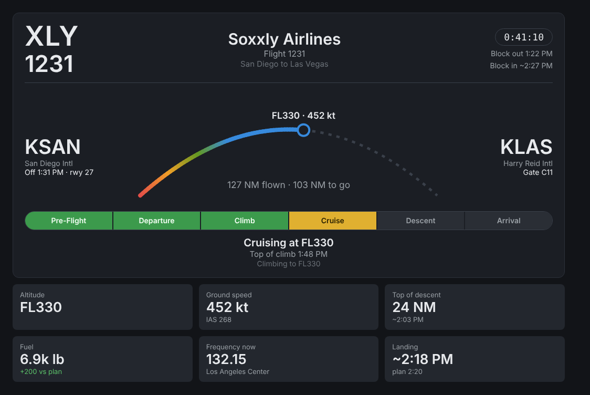

# The dashboard (after the MVP)

The design for the **Live Flight Screen**, called **the dashboard** for short, from the brainstorm with Dave on
2026-11-24. It is the first piece of "deepening the live flight" (`roadmap.md`, after the MVP) and replaces today's
three-column Live (D-139) when it's built. The header and status lines are built (milestone 12, version 0.13.0), and so are the Pre-Flight panel and the collapsing header (milestone 13, version 0.14.0); the in-flight panels aren't yet. Decisions D-150 to D-154 and D-179; built in milestones 12 and 13 (D-163), checked with replays
(`replay.md`). Nothing on the dashboard reads the wall clock (D-166).

The header, the Pre-Flight panel and the in-flight panel (brainstorm of 2026-11-26, D-191 to D-198: milestones 14
and 15) are designed. Developer mode is for a later brainstorm (milestone 16).

## Names (D-150)

- **Flight Summary:** the page for a finished flight. It's what Flights shows for a past flight, and what the dashboard
  shows below its header once a flight blocks in.
- **Dashboard (Live Flight Screen):** what Dave looks at in the sim while flying. Today's Live page.
- **Pre-Flight:** the first stage's new name (was Pre-Departure, `design.md` section 13.5).

## The idea

Once Dave is in the sim, he never has to click BlockTime again. The dashboard changes by itself with the phase of
flight, so it always shows what he needs at that moment. The top card (the header) is always there; the panel under
it changes by phase.




The pictures are sketches: the numbers are made up and the colours aren't `Theme.qml`'s.

## The header (D-151)

> **As built:** the layout below was the first design. Milestone 12 built it, then Dave reworked it on 2026-11-26
> (D-184): see "The header as built (D-184)" under milestone 12. Where the two disagree, D-184 wins.

One card across the top, in this order.

**1. Identity row, three columns.**
- **Left:** the airline's ICAO code (`XLY`) very large, the flight number (`1231`) under it, the same size or a little
  smaller. The ICAO code is larger than the airport codes.
- **Middle (the wide column), centred:** the airline name (`Soxxly Airlines`, about the airport codes' size or a
  little smaller), then `Flight 1231` in a lighter grey, then the cities: `San Diego to Las Vegas`. No callsign.
- **Right:** the block clock as a pill, then `Block out` and `Block in` in local time.
  - Block clock: the plan's block time before block out (`Plan 1:05`, greyed), a running clock from block out, the
    final block time at block in.
  - `Block out --:--` until block out, then the real time. No estimate before it.
  - `Block in ~2:30 PM`, an estimate (with `~`) until block in. Before block out it's the plan's; in flight it comes
    from the predictions (D-120) and updates as the flight goes on; at block in it's the real time.

**2. A thin horizontal line** under the identity row (Claude's call, confirmed by Dave: it separates who the flight is from
the flight happening; the arc and the pill below it stay one unit).

**3. The route arc.** The origin on the left, the destination on the right, joined by a large upward arc.
- Each end: a large departure or arrival icon, the ICAO code in large letters, the airport name much smaller under it,
  then one line that changes:
  - **Origin**, before block out: the airplane and where it's parked, `N814SX | 737 BBJ2 | Gate 41`. After takeoff:
    `Off 1:31 PM · rwy 27`.
  - **Destination:** the arrival gate once known (`Gate C11`, section 13.6). The arrival time is in the header's right
    column, so it isn't repeated here.
- The arc is a progress bar. A marker moves along it by **distance flown along the planned route** (Claude's call,
  confirmed by Dave), so it always agrees with the distance text. The marker carries only altitude and ground speed
  (`FL330 · 452 kt`); `127 NM flown · 103 NM to go` sits under the arc's middle, so labels never collide with the
  airport blocks near the ends.
- The flown part of the arc is coloured by altitude, fading smoothly (not in bands): red near the ground, through
  yellow and green, to blue at cruise, and back down. The part still to fly is a dashed grey line. (This is the
  "altitude-coloured track" idea from `roadmap.md`, on the arc.)
- A small tick could mark top of descent on the arc (sketched once; not settled).

**4. The phase pill.** A large pill-shaped bar across the full width, one section per stage: Pre-Flight, Departure,
Climb, Cruise, Descent, Arrival.
- Grey until the stage starts, yellow while it's in progress, green once it's done.
- Sections are about equal in width, not proportional to time, so Cruise doesn't swallow the bar (Claude's call,
  confirmed by Dave).
- Smaller divisions inside a section are the recorder's phases (pushback, taxi out, takeoff under Departure, and so
  on), a fixed set so the bar never changes shape. Sub-events that come and go (GSX services, level-offs) are in the
  status lines, not the bar (Claude's call, confirmed by Dave).
- The block clock is no longer at the pill's right end; it moved to the header's right column, so the pill keeps its
  full width.

**5. The status lines** under the pill, centred on it (D-152).

## The status lines (D-152)

Three lines, centred under the pill:
1. **The current line**, white and largest.
2. **The previous line**, smaller and light grey, with the time it happened where it has one.
3. **The one before that**, smaller still and darker grey.

When a new line arrives, the others move down one and the oldest drops off. Times are Dave's local time. The event
log stays out of the dashboard (it's in the flight log and, later, behind a developer mode).

**Pre-Flight**
- Starts as `Preparing aircraft for flight`. That covers flying with or without GSX: Dave can enter payload and fuel
  in the FMC himself and skip GSX entirely.
- When a GSX service is requested, the current line becomes the GSX line. **All GSX services running at the same time
  share one line**, so it never flickers through `Catering… Refueling… Boarding…`:
  `Catering in progress · Refueling in progress`, then `Catering complete · Refueling complete · Boarding in
  progress`, and so on. Each part changes in place; the line only shifts down when the next stage starts.
- `Preparing aircraft for flight` or the GSX line stays the current line until block out.

**From block out:**
`Pushback and startup` (the procedure: engines start during the push) → `Taxiing to runway 27` → `Departed runway
27` → `Climbing to FL370` → `Cruising at FL370` → … The full list, settled for milestone 12, is in "Every status line"
below.

- **Level-offs interrupt the climb line.** `Level at FL240` replaces `Climbing to FL370` while level, then the climb
  line comes back. The target level is the SimBrief plan's cruise level, even if ATC holds Dave lower.
- The takeoff roll has no event of its own, but the recorder's `takeoff` phase is one: it's logged once the takeoff is
  confirmed and timed back to where the roll began.

**At block in** (D-154): the line always becomes `Parked at gate C11`. It changes to `Deboarding in progress` only if
Dave starts GSX deboarding, then to `Ready for next flight` (D-135's "ready for shutdown or turnaround", reworded).
Until then the shutdown checklist (engines off, parking brake set, beacon off, strobes off; D-135) sits under the
status lines (D-180).

## Milestone 12: how the header is built (D-180 to D-182)

Milestone 12 builds the header and status lines above; the panels below the header come later in the instrument
panel look (D-179). Claude's calls here were approved by Dave with the design on 2026-11-25.

### What Live looks like after milestone 12 (D-180, Dave)

```
┌ header: airline line · route arc · phase pill and marker · status lines (· checklist)  ┐
└────────────────────────────────────────────────────────────────────────────────────────────┘
┌ planned flight (at the gate)            ┐ ┌ event ┐
│   or the Flight Summary (after block in)│ │ feed  │
├─────────────────────────────────────────┤ │       │
│ flight tiles (today's flight panel)     │ │       │
└─────────────────────────────────────────┘ └───────┘
```

- The header shows while there's a planned flight, an open flight or a flight summary; with nothing planned, Live is
  the tiles and the feed as today.
- Today's stages column (`FlightProgress.qml`) goes: the pill and the status lines replace it. Its Ready checklist
  moves under the status lines.
- The event feed stays as a narrow column on the right until developer mode exists (Dave). D-152 still holds for the
  dashboard's design; the feed is a stopgap.
- At block in the Flight Summary takes the planned flight panel's place below the header (D-154); today it sits above
  everything.
- Pre-Departure becomes Pre-Flight everywhere it shows (D-150).
- The replay window's Live is the same page, so replays show the header too.

### The header as built (D-184, Dave, 2026-11-26)

Dave reworked the first build from a mockup (`images/dashboard-header-v2.html`, which steps through a flight; still
images `images/dashboard-header-v2-*.png`). It's about 130 px shorter than the first build.

```
 XLY 8                     Soxxly Airlines                     ( 1:29:02 )
 ✈  ────────────────────────────────────────────────○ · · ·  ✈
 KSAN                         Flight 8                       KSJC
 San Diego International      San Diego to San Jose          Mineta San Jose International
 Departed 10:43 AM          353 NM flown · 15 NM to go       Arriving ~12:24 PM
 ( Pre-Flight | Departure | Climb | Cruise | Descent▲| Arrival )
                                              Approach
                     Final approach, runway 30L
                Descending from FL400 · 11:50 AM
               200 nm from destination · 11:35 AM
```

- **One line on top:** the airline name centred; `XLY 8` (the code and flight number, a little smaller than the airline
  name) on the left and the block clock on the right, both centred on it. No line under it, and no Block out / Block
  in lines: the airport lines carry those times.
- **The arc** is flat (its peak 28 px above its ends) and runs between the two airplane glyphs. Its ends are measured
  from the glyphs, with a gap and the marker's size, so the marker never touches a glyph at any window width. No text
  above the marker.
- **Below the arc**, centred between the airports: `Flight 8`, the cities, then the distance.
- **The airport lines:** see the table below (`Departing soon` → `Departed 10:43 AM`; `Arriving ~12:24 PM` →
  `Arrived 12:24 PM · Gate 4`).
- **The pill and its marker:** below.
- **The status lines** sit a little lower. A new line rolls in from above (tipped back about its top edge, settling
  with a bounce) while the others drop a slot, getting smaller and greyer, and the oldest fades out. A line that
  changes in place, and a rebuild (the page opening, a replay seek), don't animate. The animations last about half a
  second and run only on a change, within the no-continuous-animation rule.
- **For later (not decided):** on a summary, the pill and status lines may be better gone from the header (see "Open
  before building").

### Where each value comes from

| Header part | Source |
|---|---|
| `XLY`, `Soxxly Airlines` | the airline configuration (`airline.yaml`) |
| Flight number | the planned flight |
| `San Diego to Las Vegas` | the origin's and destination's **city**, a new airport column filled by `blocktime-import` from OurAirports' `municipality` (D-181); the airport's name when a city is empty |
| Airport names | the airport table, as stored; long names are cut with `…` |
| Block clock | `Plan 1:05` (the plan's block time, greyed) before block out, then the running clock, then the final time |
| Origin line (D-184) | `Departing soon` until liftoff, then `Departed 1:22 PM`: block out's time. A summary shown at app start has no block events, so just `Departed` |
| Destination line (D-184) | `Arriving ~2:27 PM` until block in, then `Arrived 2:24 PM · Gate C11`: block in's time (the brake set) and its spot. The estimate, until the predictions (D-120): before block out, now plus the plan's block time; from block out, block out plus the plan's block time; no plan, the line is empty. At app start with a summary: `Arrived`. **Milestone 15 changes it** to `Arrival 2:27 PM` with `On time` / `Early ~4m` / `Delayed ~4m` under it (D-192, "The header as the passenger view" below) |
| Marker | none: the altitude and speed above it went (D-184); the steam gauges will show them (D-179) |
| `127 NM flown · 103 NM to go` | route progress, below |
| Pill | the six stages; the marker's place from the current phase, and in Pre-Flight from GSX boarding |
| Status lines | a new plain C++ class fed the same events as the stages, below |

Altitudes read as flight levels at and above the origin's transition altitude while climbing and cruising, and above
the destination's transition level in the descent (both from the plan; 18,000 ft without one), else as feet. Lines
from an event with the recorder's `flight_level` flag use the flag; the marker and `Climbing to FL370` have no flag,
so the app applies the same rule as `FlightTracker::flightLevel`, shared as one plain function.

**After block in** the planned flight models hold no flight (they clear it at settling), but the header still needs the
flight number, cities, plan and navlog. It reads them from the settled flight (`flownFlightView`, extended to carry the
stored OFP's navlog), as the replay already does.

**The arrival gate** no longer shows in the header (D-184): the status line names it (`Taxiing to Gate C11`), and at
block in the destination line shows the spot Dave actually parked at (`block_in`'s `parking`).

### Route progress (D-182)

- **The route** is a line through the origin airport, every fix in the stored SimBrief plan's navlog (`pos_lat`,
  `pos_long`; the plan is kept verbatim, so nothing is fetched) and the destination airport. Without a plan it's the
  straight line between the airports.
- **Distance flown** is the latest position projected onto that line, searching forward from the last matched leg so a
  SID or STAR that doubles back can't jump the marker, and never going down. It stays 0 until liftoff and becomes the
  whole route at block in. "To go" is the route's length minus that, so the two always add up. Whole NM.
- **The arc's colours:** the highest altitude seen in each 1% of the route is kept, from the samples. Each piece of the
  flown arc takes its colour from that altitude as a share of the plan's cruise altitude (35,000 ft without a plan):
  red at the ground, yellow at about a third, green at about two thirds, blue at cruise, blending smoothly. The arc is
  drawn as short segments and redrawn only when a piece changes.
- The top-of-descent tick waits for the predictions (D-120).

### The pill and its marker (D-184, replacing D-182's divisions)

- Sections: grey until the stage starts, **green** while it's in progress, **cyan** once it's done.
- A **marker** under the pill, its point a few pixels into it: a red square with a pointed top, raised (a gradient, a
  thin white edge, a shine along the point and a small shadow). It sits in the middle of the current sub-phase's
  equal part of the current section and slides to the next one with a slight bounce. The sub-phase's name is in small
  text under it.
- Sub-phases: Pre-Flight **Preparing, Boarding** (once GSX boarding has started); Departure **Pushback, Taxiing,
  Takeoff**; Climb and Cruise one part with **no text** (it would repeat the section name; the marker stays so it
  never seems to vanish); Descent **Descending, Approach** (a go-around counts as approach); Arrival **Landing,
  Taxiing, At Gate**.
- **Arrival starts at touchdown** (the recorder's Landing phase, the first sample on the ground), not at block in.
  The stages' Landed and Taxiing to gate lines move to Arrival with it.

### Every status line (D-182)

| When | Current line |
|---|---|
| A planned flight at the gate, no GSX service yet | `Preparing aircraft for flight` |
| A GSX service starts or finishes, before block out | `Catering complete · Refueling in progress`: every service of this leg so far, changing in place. It starts when GSX is performing the service, as `GsxTimeline` counts it; a request alone changes nothing (Claude's call) |
| Phase pushback | `Pushback and startup` |
| Phase taxi out | `Taxiing to runway 27` (the departure runway Live shows: the ATIS's, else the plan's; `Taxiing to runway` without one) |
| Phase takeoff | `Takeoff roll` |
| `liftoff` | `Departed runway 27` |
| Phase climb | `Climbing to FL370` (the plan's cruise level; `Climbing` without a plan) |
| `level_off` in the climb, descent, approach or go-around | `Level at FL240`, in place of the current line; `level_off_ended` puts that line back, also in place |
| Phase cruise | `Cruising at FL370` |
| `step_climb`, then its end | `Leaving FL370` (the event knows only the level it left, not which way: a ruling while building), then `Cruising at FL390` (or `FL350` after a step down) in place |
| Phase descent | `Descending into Las Vegas` (the destination's city) |
| Phase approach | `Approach into Las Vegas` |
| Final approach (the event the stages' `Final approach, runway …` line uses) | `Final approach, runway 26L` |
| Phase go-around | `Go-around` |
| `touchdown` | `Landed on runway 26L` (the final approach's runway; `Landed` without one) |
| `landing_runway` | corrects that line's runway in place, wherever it now is: in the recorded flights it comes with taxi in, after it |
| Phase taxi in | `Taxiing to Gate C11`: the gate's name as it reads (`Taxiing to Terminal A Gate 4`, `Taxiing to Parking 70`), since BlockTime's spot names include the word; `Taxiing to gate` without one |
| `block_in` | `Parked at Gate C11` (block in's spot as it reads; `Parked` without one), with the shutdown checklist under the lines |
| GSX deboarding | `Deboarding in progress`, then `Deboarding complete`, in place |
| Ready (D-135, unchanged: deboarding completes, or without GSX the checks pass) | `Ready for next flight` |

- The shutdown checklist (engines off, parking brake set, deboarding complete when GSX deboarded, beacon off, strobes
  off) shows from block in until the summary is dismissed, ticking as items pass, so a beacon left on after Ready is
  still visible (Claude's call; D-135's trigger for Ready is unchanged).

- The previous lines show the local time they started: `Climbing to FL330 · 1:33 PM`.
- A line that changes in place (GSX, level-offs, deboarding) doesn't push the others down or animate.
- Markers (10,000 ft, transition altitude, 200 nm out) don't become status lines; they're in the feed.

### Testing

No fixture has a navlog yet: copy a real OFP from Dave's database (`flight_simbrief_plan.ofp_json`) into `tests/data/`,
cut down to the fields BlockTime reads and with his SimBrief user details removed, and note the navlog's fields in
`notes/simbrief-api.md`.

Plain C++ with tests first: reading the navlog, route progress, the altitude pieces and their colours, the status lines
(from the recorded flights in `tests/data/` and made-up events), the header's texts and times, and migration 9 with the
import's city. Then Live is checked on Dave's real flights with `--replay last --at … --grab` at the gate, in taxi, in
a climb level-off, in cruise, on final and at block in, and with `--demo`. No sim test.

### Left to the builder

Sizes, fonts and colours (all in `Theme.qml`), the departure and arrival icons (Segoe Fluent Icons), class and file
names, how the header shrinks on a short window, and the airplane type's short name in the origin line.

## The instrument panel look (D-179)

Everything below the header is drawn as an **inset instrument panel**: recessed into the page, darker than the cards
around it, with small screw heads in its corners. The header itself stays flat. Dave has the real gauges, switches and
lights in the sim, so the dashboard isn't there to repeat numbers: it has to be fun to look at. Numbers in flat cards
were fine for the MVP and are lifeless after it.


A sketch with made-up numbers; the HTML it was drawn from is `images/dashboard-instrument-panel.html`.

- **Steam gauges** for values that move: airspeed (with the Mach number in a small window), altitude (a pointer for
  hundreds, a counter, the altimeter setting in a small window), vertical speed, fuel (with a red low-fuel arc). Black
  faces, white ticks and needles, a metal bezel, a faint glare on the glass.
- **Indicator lamps** for what the debrief's checks score (`debrief.md` section 2): beacon, strobes, landing lights,
  seat belts, APU, altimeters on STD, gear down. Each is a small domed glass button in a metal ring with an
  incandescent bulb behind it: a warm glow when lit, dark tinted glass when off, an engraved placard under it. The
  recorder already logs all of them (`beacon` and `strobe` in telemetry, the rest in the `cockpit` event).
- Claude's calls (confirmed by Dave, 2026-11-25):
  - Each lamp has its own lens colour: beacon red, strobes and landing lights white, seat belts and APU amber,
    STD and gear green.
  - A small amber **bug** on a gauge marks the plan's value (cruise speed, planned fuel now).
  - Numbers that aren't natural dials (frequency, top of descent, landing time) are **radio-stack readouts**: amber
    digits glowing in a dark window.
  - A needle **glides** briefly to each new value (telemetry comes at most once a second, so it would otherwise jump)
    and is still between changes: no continuous animation (budget under 1% CPU). **Since 0.15.1 (D-205)** it glides
    over the whole second, linearly, so it moves steadily a second behind the sim.
- Open, for the panels' brainstorm: whether a lit lamp means only "switch on", or also warns when the switch is wrong
  for the moment (landing lights off below 10,000 ft); which gauges and lamps each phase's panel shows; how the
  Pre-Flight panel's load sheet and clearance (D-153) take the look (a transponder-style squawk, radio-stack
  frequencies).
- Every colour and size goes in `Theme.qml` like the rest (D-054).

## Below the header, by phase

### Pre-Flight panel (D-153)

Everything Dave needs to set up the aircraft at the gate, so BlockTime is the only window open beside the sim until
pushback (D-118). Takeoff performance still comes from the PMDG EFB; the dashboard shows its inputs and calculates
nothing. All weights in pounds. No centre of gravity.

**Load sheet** (from the SimBrief plan and the configuration's seats and holds, `design.md` section 17)
- **Block fuel:** the total that should be on board (what goes into the FMC), not the amount to add.
- **Zero fuel weight.**
- **Passengers**, split by class when the airplane has more than one.
- **Cargo**, split into the holds at the configuration's ratios, summing to SimBrief's cargo figure. A freighter shows
  only the cargo.
- A small line with the **cruise level and the transition altitude** (`FL400 · Trans alt 18,000`; Dave, D-187: not
  the flight number, cost index or reserves).
- Cargo is SimBrief's `weights.cargo` (bags and freight together), split with the airplane's hold ratios (D-188).

**Departure** (the EFB's inputs; ATIS polled about every 5 minutes, D-118)
- **Gate (D-206, 0.15.1):** where to load in, the spot the airplane last parked at (`4` for Gate 4; a dash when
  unknown), first in the group beside the ATIS letter.
- **Runway:** the plan's at first, then the ATIS's from SayIntentions, which may differ. When it differs from the plan,
  say so (the plan's SID may be wrong too).
- Runway **heading** and runway **condition**.
- **Wind** and **outside air temperature** at the origin.
- **Altimeter** in the unit the ATIS gives (inHg in the US, hPa elsewhere).

**Clearance** (once SayIntentions gives the pre-departure clearance)
- **SID and runway before the clearance** (Dave, D-189): the panel shows SimBrief's SID (`PADRZ2 IKAYE`) and runway
  from the start. When ATC changes either, the panel follows ATC, marked as changed. If ATC doesn't change them,
  SimBrief's stay.
- **SID:** SayIntentions leaves off the transition, so match its SID name against the plan's and show the plan's full
  form: SayIntentions says `via the ZOOO4 departure`, the plan has `ZOOO4 MTBAL`, the dashboard shows `ZOOO4 MTBAL`.
  If SayIntentions gives a SID the plan doesn't have, show it and mark it as changed (reprogram the FMC).
- **Initial altitude:** `4,000 ft` or `Climb via SID`.
- **Squawk** (Claude's addition: needed before pushback).
- **Departure frequency** from the clearance (Claude's addition; it can differ from the published list).
- **Taxi route**, once ground gives it.
- **A 30-minute countdown** from the clearance, for when it expires. It disappears at block out. (Claude's suggestion:
  amber, then red in the last 5 minutes.)

**Frequencies, all flight long.** Always the frequency Dave should be on now and the one he'll need next: clearance and
ground at the gate, ground and tower after block out, and so on. **Not in milestone 13** (D-187): it moves to the
in-flight panels' brainstorm. Until then, only the clearance's departure frequency shows.
**Dropped (D-191):** no frequency anywhere on the dashboard, and milestone 14 takes the departure frequency off this
panel too. Dave reads frequencies in the SayIntentions window, which is open on every flight.

**Milestone 13's calls** (D-187, D-188; plan `plans/2026-11-26-milestone-13-preflight-panel.md`):
- The panel shows from planning until liftoff, right under the header. The countdown hides at block out.
- ATC and the origin's ATIS are polled at the gate (the ATIS every 5 minutes), so the clearance shows before
  pushback.
- The runway shown is ATC's latest (taxi or `Expect runway`), else the ATIS's, else the plan's. The heading is the
  plan's TLR magnetic course. The wind comes from the spoken ATIS, else the METAR. The condition is the plan's TLR
  surface, or Wet with precipitation in the METAR.
- **The header collapses** with a click anywhere in the pill bar (D-187). Collapsed, it shows the origin code, the pill
  and the destination code in one row, the marker with its label, and the current status line. It's remembered across
  restarts.

**As built (milestone 13, 0.14.0):** to the approved mockup `images/dashboard-preflight-v1.html` (stills
`images/dashboard-preflight-v1.png`, `-changed.png`), on Live and in the replay window; the app's own look at taxi with
the header collapsed is `images/dashboard-preflight-built.png`.
- Code: `PreFlightLog` (`src/preflight_log.h`: what the origin's ATC and ATIS said since planning, and the departure and
  clearance views), `loadSheet` (`src/load_sheet.h`), `parsePlanBrief` (`src/plan_brief.h`: the OFP's SID,
  transition, ZFW, cargo and takeoff runways), the ATC readers (`src/atc_message.h`, D-168; `src/clearance.h`), the
  condition readers (`src/departure_conditions.h`), `PreFlightModel` and `qml/PreFlightPanel.qml`, with
  `qml/InstrumentPanel.qml` and `qml/Readout.qml` ready for the in-flight panels.
- Each readout's tag says where a value came from: `PLAN`, `ATIS`, `ATC` or `CLEARED`, or an amber flag `PLAN 27` /
  `PLAN PADRZ2` when ATC or the ATIS changed the plan's (D-189). The countdown says `CALL FOR A NEW ONE` in its last 5
  minutes.
- The readouts' glow is a translucent outline, not a blur: it draws on every renderer, including the software one the
  offscreen grabs use.
- In logs from before 0.14.0 the clearance was logged at block out, so a replay of an older flight shows it only from
  block out.

### Cruise (draft, superseded)

Altitude, ground speed (with IAS), top of descent (distance and local time), fuel against plan, the frequency now, and
landing time against plan. First sketched as data cards, then in the instrument panel look (D-179, sketch above).
Replaced by the in-flight panel below (D-194).

### The in-flight panel (brainstorm of 2026-11-26, D-191 to D-198)

Designed with Dave on 2026-11-26 from the mockup `images/dashboard-inflight-v1.html`, which steps through ten moments
of the KSAN → KSJC leg. ATC's words in it are real; the times, gauge values and the lamps left wrong are made up. Dave
approved its direction. What changed after it is marked **(after v1)** below, so milestone 14 starts with a v2 mockup.

**Approved: mockup v2** (`images/dashboard-inflight-v2.html`, stills `images/dashboard-inflight-v2.png`, `-approach.png`,
`-final.png`; Dave, 2026-11-26, D-203). It is laid out for Live at the smallest window (1100 × 760, so 900 px beside the
sidebar). What v2 changed is folded into the sections below and marked **(v2)**.

**Why.** Two different readers:
- **The panel is Dave's.** In flight he wants to know what to set in the MCP altitude window ("I never know what to
  set when they say climb via the SID"), what ATC last cleared him for, which switch the debrief will mark down, and
  how the flight is going against the plan. And it has to be fun to look at (D-179): gauges and lamps, not flat cards.
- **The header is the passengers' and the family's** (D-192): the arrivals board at the destination, or the seat-back
  map on the airplane. Someone picking up a passenger watches the arrival time. That makes BlockTime feel like part
  of an airline, not just a flight dashboard.

**Goals:** the ATC card always shows the altitude to set; lamps flash only when something is wrong now; the arrival
time is right through holds and delays.

**Non-goals:** radio frequencies anywhere (D-191: the SayIntentions window has them); developer mode (milestone 16);
a performance calculator (the PMDG EFB does it, D-118); reading the PMDG FMC.

**Anti-goals** (failures even if they work):
- Lamps that nag about what the debrief doesn't score: seat belts off in cruise, or turned on for turbulence.
- A guessed clearance. If BlockTime can't read an ATC call, the slot keeps its old value; it never invents one.
- Panels that animate all the time. Only a change animates, apart from a lamp flashing while something is wrong.
- Repeating the PMDG's numbers in flat cards.

#### When it shows (D-194)

- **From block out to block in.** The Pre-Flight panel shows until block out (it was until liftoff, D-188), so the
  beacon lamp and the taxi speed gauge are there for pushback. The taxi route moves from Pre-Flight into the ATC card.
- **After block in it stays until Finish Flight (D-207, 0.15.1):** the button sits right of the readouts' placard;
  Dave clicks it once shut down and deboarded, and the Flight Summary takes the panel's place. The flight is settled
  at block in as before. A flight settled at startup shows its summary at once.
- On Live and in the replay window, like the Pre-Flight panel.

#### Layout (D-194)

One inset panel (D-179), top to bottom:

```
┌ screws ─────────────────────────────────────────────────────────────────────────┐
│   (BEACON) (STROBE) (LANDING) (SEAT BELTS) (APU) (ALT STD) (GEAR DN)            │
│ ─────────────────────────────────────────────────────────────────────────────── │
│   [ SPEED ]        [ ALTITUDE ]       [ VERTICAL SPEED ]     [ FUEL ]           │
│   ATC                                                                           │
│   [ ALTITUDE       ] [ ROUTE / HEADING ] [ SPEED ] [ APPROACH       ]           │
│   <PHASE>                                                                       │
│   [ SOULS ] [ FUEL REMAINING ] [ readout ] [ readout ]                          │
│   [ readout ] [ readout ] …  (four a row)                                       │
└─────────────────────────────────────────────────────────────────────────────────┘
```

- **(v2)** The lamp strip across the top, the four gauges under it, the ATC card across the panel, then the phase's
  readouts under it, four a row (APPROACHES takes two). Side by side, the 900 px panel cut off "DESCEND VIA SILCN6".
- **(v2)** The ATC card's columns are uneven (ALTITUDE and APPROACH wide, SPEED narrow). Before the takeoff roll
  ALTITUDE and ROUTE stand where they will be airborne and TAXI takes the APPROACH column, with SPEED's place empty.
  After touchdown TAXI and HOLD SHORT take the first two.
- **(v2)** Every readout's aside (a qualifier, a source tag or the time of the call) is on its title row, so the amber
  window holds only the value. The Pre-Flight panel's readouts change to match (one `Readout.qml`).
- With the header collapsed, the panel fits a 760 px window in every phase (the arrival ATIS, the tallest, ends near
  715 px).

#### Lamps (D-195)

Beacon, strobes, landing lights, seat belts, APU, ALT STD and gear down, as in D-179 (each lamp its own lens colour).
**Lit means on, dark means off** (ALT STD lit = both altimeters on STD; GEAR DN lit = gear down). **A lamp flashes,
1 s lit and 1 s dark, while its switch is wrong right now**, and stops as soon as it's fixed or its window closes.

"Wrong" follows the debrief's checks (`debrief.md` section 2), so the panel never nags about something that isn't
scored. Outside these windows a lamp never flashes, whatever its state.

| Lamp | Flashes while | Check |
|---|---|---|
| Beacon | off, from 10 s after the earlier of block out and the first engine start, until it's first on (then switching it off isn't scored) | 1 |
| Seat belts | off, from the start of taxi out until the climb passes the origin's **transition altitude** (Dave's rule; check 2 moves there too, D-200); and off from the descent's `transition_level` marker until block in. Never while on, and never in between: Dave may keep them on to the top of climb, or switch them on for turbulence | 2, 8 |
| Strobes | off, from 10 s into the takeoff roll until liftoff; on, from 180 s after taxi in began, until they're first off after it (on again to cross a runway isn't scored) | 5, 12 |
| Landing lights | off, from 10 s into the takeoff roll until liftoff; off, from 60 s after `below_10000` until touchdown | 5, 10 |
| APU | on (the selector), from the climb's `transition_altitude` marker until it's first off (started again on taxi in isn't scored); off, from block in until the last engine stops (D-173: it may go on once parked; not built, D-201) | 13, 14 |
| ALT STD | not on STD, from 60 s after the `transition_altitude` marker until the `transition_level` marker or until both are first on STD; still on STD, from 60 s after `transition_level` until touchdown | 7, 9 |
| Gear down | up, from the landing approach's `final_approach` marker until touchdown | 11 |

- What counts as "on" (seat belts AUTO, the 737's retractable lights) is whatever the debrief's measurement already
  uses; the lamps share its reading of the `cockpit` event, not a copy of it.
- Checks 1, 7, 12 and 13 measure the time until the switch is first right, so those lamps stop at the first fix
  (D-204, after the milestone 14 review): the table as first written ran them to block in or the transition level and
  would have flashed for what the debrief never scores.
- Lamps whose data isn't in the log (no PMDG broadcast, D-159) stay dark and never flash, as the debrief marks those
  checks not checked.
- **The flashing is the one exception** to "no continuous animations" (D-195): it runs only while something is wrong,
  and toggling one lamp's look once a second costs next to nothing.

**Open, for Dave (milestone 14's plan):** check 2 scores the seat belts from taxi to **10,000 ft** (`above_10000`),
but Dave's rule is "on until at least the transition altitude". Should check 2 move to the `transition_altitude`
marker too, so the lamp and the debrief agree? That changes check 2's stored measurement for new flights only
(D-160); old flights keep theirs. **Settled (D-200, Dave): yes.** Milestone 14 moves check 2's window to end at the
`transition_altitude` marker for new flights, with tests that old flights keep their stored measurement, and updates
`debrief.md`.

#### Gauges (D-196)

Steam gauges as in D-179 (black faces, metal bezels), 200 px (D-209), each needle gliding over the second to the next
sample (D-205, 0.15.1).

- **Speed.** On the ground below 40 kt: **ground speed, 0 to 40 kt**, with a red arc from 30 to 40 kt (check 3's taxi
  limit). Otherwise **indicated airspeed, 0 to 400 kt**, with the Mach number in a small window. The face switches at
  40 kt, both ways (takeoff roll and landing rollout); the switch flips the gauge (below). An amber bug marks **VREF**
  (the `cockpit` event's `vref_kt`) from the Approach phase to touchdown, and the plan's cruise speed in cruise
  (milestone 15, with the other plan values).
- **Altitude (D-202).** Three hands on a 0–9 dial, read like a clock, with no drum:
  - a short, wide hand for the ten thousands, like the hour hand (at FL370 it points just past 3);
  - a long hand for the thousands, like the minute hand (at FL370 it points at 7);
  - a long, skinny hand for the hundreds, like the second hand: one turn per 1,000 ft, so it sweeps in a climb and
    rests in cruise.

  The altimeter setting stays in a small window: `STD`, or the value in the unit the altimeters use.
- **(v2) Radio altitude** (Dave, D-203). **Since 0.15.1 (D-209): below 300 ft above the ground, back to the altimeter
  above 500 ft, on a 0-500 ft dial numbered 0-5 (`FT × 100`) evenly over the whole dial; the `final_approach` marker
  only arms it, and after a go-around it comes back below 300 ft once armed again (above 500 ft or the next marker).**
  As first built: below 2,000 ft above the ground (`alt_agl_ft`) the altitude gauge flips to a
  radio altitude dial, 0 to 3,000 ft, with the bottom 500 ft over half the dial so the flare is readable, numbered
  0–30 and `FT × 100` along the bottom of the circle. It flips back above 3,000 ft, so terrain under an approach
  can't make it flicker between 2,000 and 3,000 ft. It starts on the radio face at block out (on the ground). A
  go-around flips it back to the altimeter at once, and the radio face returns at the next `final_approach` marker
  (or by the 2,000 ft rule once the airplane has been above 3,000 ft). The setting window is on both faces.
- **Vertical speed.** 0 at nine o'clock, ±6,000 fpm, as in D-179's sketch.
- **Fuel.** Total fuel in lb, from 0 to the block-out fuel rounded up to 6,000 lb, with a red low-fuel arc up to
  SimBrief's final reserve. **(v2)** A window shows the pounds (`7,410`). Milestone 15 adds the amber bug at the
  plan's fuel for this point; its `+200` / `−300` against the plan needs another place, since the window now holds the
  pounds.

#### The ATC card (D-197)

The gist of what ATC cleared, not ATC's words, so Dave knows what to set. Read from the logged `atc_exchange` lines
(ATC's side, `outgoing_message`) through D-168's plain form, from every airport and center on the flight.

**Slots.** Each slot changes only when ATC changes it, and shows the time given or a qualifier on its right (the
readout's aside). **LATEST** marks every slot the last transmission changed (**(v2)** the slot's placard lit amber,
like an annunciator, instead of a separate tag): one call can change three ("Turn left
heading 320. Descend and maintain 2,700 until established on the localizer. Cleared for the ILS runway 30L approach.").

| Where | Slots |
|---|---|
| Block out to the takeoff roll | ALTITUDE (the clearance's initial altitude), ROUTE (the cleared SID, matched to the plan's full form as on Pre-Flight), TAXI (`A, A7, B, B1`, aside `RWY 27`) |
| Airborne | ALTITUDE, ROUTE or HEADING, SPEED, APPROACH |
| From touchdown | TAXI (`K`, aside `TERMINAL A GATE 4`), HOLD SHORT (`30R`) |

What each slot shows, from the KSAN → KSJC log (`tests/data/flight-ksan-ksjc`) and Dave's examples:

| ATC says | Slot | Shows |
|---|---|---|
| Clearance: "Climb via the SID. Expect FL400 one-zero minutes after departure" | ALTITUDE | `CLIMB VIA SID`, aside `EXP FL400 +10 MIN` (until the first altitude clearance) |
| "Climb and maintain FL220" | ALTITUDE | `FL220` |
| "Descend via SILCN6, TROXX transition" | ALTITUDE, ROUTE | `DESCEND VIA SILCN6`; `SILCN6 TROXX` |
| "Descend and maintain 2,700 until established on the localizer" | ALTITUDE | `2,700`, aside `UNTIL ESTABLISHED` |
| "Turn left heading 320" (also "fly heading 340") | HEADING (the ROUTE slot renamed) | `320`, aside `LEFT` |
| "Maintain 210 knots" / "resume normal speed" | SPEED | `210 KT` / empty |
| "Expect the ILS runway 30L approach via KLIDE transition" | APPROACH | `EXP ILS 30L`, aside `KLIDE` |
| "Cleared for the ILS runway 30L approach" | APPROACH | `CLEARED ILS 30L`, keeping the expect call's transition as its aside (`KLIDE`, D-208) |
| "Expect the RNAV-Z runway 27 approach via the KLOMN transition"; "Cleared for the RNAV-Z runway 27 approach, via KLOMN" | APPROACH | `EXP RNAV-Z 27`, aside `KLOMN`; then `CLEARED RNAV-Z 27 KLOMN` (D-208) |
| "Expect the Sweetwater Visual runway 27 approach" | APPROACH | `EXP SWEETWATER VISUAL 27` (D-208) |
| "Cleared RNAV Y runway 27 approach, LYNDI transition" (Dave's example) | APPROACH | `CLEARED RNAV-Y 27 LYNDI`: ATC's transition is always shown when given |
| "Runway 30L, … Cleared to land" | APPROACH | `CLEARED TO LAND 30L` |
| "Contact Los Angeles Center on 134.575", traffic calls | none | nothing changes: cruise shows the level ATC last gave |

- A phrase BlockTime can't read changes nothing (an anti-goal above). Fix new wording from the log, like milestone
  13's readers.
- **ATC is fetched every 30 s from block out to block in** (D-200; it was every 60 s), so a clearance reaches the card
  within half a minute. `FlightWatcher` fetches the whole history each time; a whole flight is about 50 exchanges.
- Settled in D-201: a go-around clears APPROACH; "proceed direct KLIDE" sets ROUTE `DIRECT KLIDE` and "resume own
  navigation" `OWN NAV`; "cross runway 30R" sets HOLD SHORT `CROSS 30R`; LATEST stays until the next transmission
  that changes a slot.

#### Phase readouts (D-194)

The readouts change with the phase. **(M15)** marks what needs the predictions; milestone 14 leaves those out and
shows what it has.

**(v2) In every phase, first** (Dave, D-203: what ATC asks for in an emergency). They never move or flip at a phase
change:
- **SOULS:** passengers plus crew, with `44 PAX + 5 CREW` beside it. The crew is what BlockTime pays for
  (`design.md` section 10): the pilots for the plan's block time and the flight attendants for the seats installed
  (×3 on the executive BBJ2, none on a freighter).
- **FUEL REMAINING:** hours and minutes at the plan's own average burn: fuel on board ÷ (SimBrief's ENDURANCE for its
  takeoff fuel, `times.endurance` against `fuel.plan_ramp − fuel.taxi`; about 4,820 lb/h on KSAN → KSJC). It counts
  down with the fuel and never jumps with thrust. Without a SimBrief plan it shows a dash.

| Phase | Readouts |
|---|---|
| Departure (block out to liftoff) | RUNWAY (with its heading and source tag, as Pre-Flight), SQUAWK, WIND, ALTIMETER: Pre-Flight's departure values |
| Climb | CRUISE level; TOP OF CLIMB, TOP OF DESCENT, LANDING **(M15)** |
| Cruise | DEST ATIS (letter and runways: the destination ATIS is fetched from the `within_200nm` marker, D-200, not from top of descent), ARR GATE; TOP OF DESCENT (distance and local time), LANDING (time and the plan's), FUEL AT LANDING (and the plan's) **(M15)** |
| Descent and Approach | **The arrival ATIS** (below) and the plan against ATC: the STAR and the landing runway with the amber `PLAN …` flag when ATC's differ (as D-189 on Pre-Flight) |
| Short final (the `final_approach` marker, 1,000 ft AGL, to touchdown) | WIND (the tower's from the landing clearance, else the ATIS's), RUNWAY, VREF (with the landing flaps). **(v2)** No HEIGHT: the radio altitude dial shows it |
| Arrival (touchdown to block in, and until Finish Flight) | LANDING: the stars, the touchdown rate and the G (`−562 FPM · 1.41 G`, D-209; D-158's rating, as soon as the touchdown and bounces are logged), ARR GATE |

**ARR GATE (D-206, 0.15.1)** is last in Cruise, Descent and Approach, Short final and Arrival: `arrival_gate`'s spot
(`7` for Gate 7, `Parking 70` as it reads), a dash until SayIntentions picks it, usually in cruise.

**The arrival ATIS (after v1).** The destination ATIS gives everything the PMDG EFB's landing calculation asks for and
what Dave needs to load the approach before ATC says "expect". From the logged KSJC ATIS ("INFO JULIET … ARVG AND
DPTG RWYS 30L, 30R. WIND VRB AT 4 … TEMP 17 … ALTIM 30.19. ILS RWY 30L AND RNAV-Z RWY 30R APCHS IN USE"):

| Readout | Example |
|---|---|
| ATIS | `JULIETT` |
| RUNWAYS | `30L 30R` (arriving) |
| APPROACHES | `ILS 30L · RNAV-Z 30R`; a named visual keeps its name, `SWEETWATER VISUAL 27` (D-208) |
| WIND | `VRB 04` |
| OAT | `17 °C` |
| ALTIMETER | `30.19 inHg`, aside `SET AT TL` |
| CONDITION | `DRY`, or `WET` with precipitation in the METAR (as Pre-Flight) |

Visibility, clouds, dew point and the remarks are left out: they change nothing Dave sets.

**The ATIS letter as a word (D-193), everywhere:** `JULIETT`, not `J`, on this panel and on Pre-Flight, in the ICAO
alphabet with its own spelling (ALFA, BRAVO, … JULIETT, … XRAY, … ZULU; Dave, D-201).

#### Flips (D-198)

- **A card or gauge flips when its content changes,** never the whole panel: a half-turn about its horizontal axis
  with a little perspective, the new content showing from the midpoint, about half a second. Like a flip clock.
- What flips: an ATC slot with a new value; a readout whose title or value changes because the phase changed; the
  speed gauge switching between ground speed and airspeed.
- What doesn't: values that tick (times, distances, the needles), and a rebuild (the page opening, a replay seek), as
  with the status lines (D-184).
- **A wave:** when several change in one update, they flip one after another from left to right across the panel,
  each starting about 60 ms after the one to its left, by position whatever the row (Claude's call).
- Within the no-continuous-animation rule: it runs only on a change.

#### As built (milestone 14, 0.15.0)

To the approved mockup v2. The app's own look on the approach call is `images/dashboard-inflight-built.png` (a replay of
KSAN → KSJC at 1:10 with the header collapsed).
- Code:
  - `cockpit_reading.h`: the debrief's reading of the cockpit and altimeter lines and the windows' times, shared with
    the lamps;
  - `LampBoard` (`lamps.h`);
  - `readInstructions` (`atc_instructions.h`) and `AtcCard` (`atc_card.h`, `slotsFor()`, since `slots` is a Qt macro);
  - `inFlightReadouts` and `panelPhase` (`inflight_readouts.h`);
  - `AltitudeFace` (`altitude_face.h`);
  - `fuelRemainingMinutes` (`plan_brief.h`), `crewFor` (`pricing.h`), `landingFacts` / `landingStars` (the
    debrief's);
  - `InFlightModel`, and `qml/InFlightPanel.qml` with `Lamp`, `FlipCard`, `SteamGauge` (plus `GaugeScale`,
    `GaugeArc`, `GaugeNeedle`, `GaugeWindow`), `SpeedGauge`, `AltitudeGauge`, `VsiGauge` and `FuelGauge`.
- **Cockpit lines reach the app.** They are written to the log and handed to the app, and replays play them. In a
  replay they're state, like samples: they don't move the start 15 s before the first event, and the ones before it
  are kept at the start.
- **Rebuilds don't flip.** The cards and lamps are fixed slots fed by index, so the lists rebuilt with every sample
  never recreate them. A replay seek holds the model's `animate` off until the event loop has drawn the result, so it
  doesn't flip.
- **The ATC card:**
  - touchdown clears TAXI and HOLD SHORT, so the taxi in starts empty;
  - a slot without a qualifier shows ATC's time of the call;
  - in logs from before 0.15.0, ATC lines reach the log at the next fetch, so a replay shows a clearance up to a
    minute after ATC's time.
- **Sizes:** gauges are 128 px and readout windows 30 px (the Pre-Flight panel's too), so the tallest view (the
  arrival ATIS) fits a 760 px window with the header collapsed. **0.15.1:** gauges 200 px (D-205, D-209); Live scrolls.

#### The header as the passenger view (D-192, milestone 15)

The destination line becomes the arrivals board:

```
KSJC
Mineta San Jose International Airport
Arrival 12:35 PM
Delayed ~3m
```

- **`Arrival 12:35 PM`, no `~`** (it was `Arriving ~12:24 PM`). The time keeps moving with the estimate; the line under
  it says how that compares: `On time`, `Early ~4m` (green) or `Delayed ~4m` (red). In a hold the arrival time slips
  minute by minute and `Delayed` grows with it.
- **On time is measured against block out plus the plan's block time,** fixed at block out (Dave: BlockTime has no
  timetable). So the flight is always on time at pushback; only the flight itself makes it early or late.
- **Before block out:** `Arrival` is now plus the plan's block time (as today), with no line under it.
- **Within 2 minutes either way it reads `On time`** (Claude's call: it keeps the line from flickering).
- **At block in it freezes:** `Arrived 12:35 PM · Gate 4`, and `Delayed 3m` (or `Early 2m`, `On time`) without the `~`.
- **Collapsed,** the On time / Early / Delayed line shows small under the destination code (as in the v1 mockup).
- **The distance line adds the altitude and the speed (Dave, D-210):** `127 NM flown · 103 NM to go · FL110 · M.74`.
  Feet up to 10,000 ft (`10,000 FT`), a flight level above it; knots (`430 KT`) or Mach by D-140's rule (Mach from
  0.70, knots again below 0.66). To settle in the plan: Dave's 10,000 ft line against the transition altitude the
  header uses elsewhere, and indicated or ground speed.
- The block clock, origin line and the rest of the header are unchanged.

#### The predictions (D-192, milestone 15; refines D-120)

From the stored SimBrief navlog (D-182 already reads its fixes) and the route progress the header computes:

- **The arrival time is now plus the plan's time from where the airplane is to the gate**: the plan's remaining
  enroute time from the current position along the route (interpolated between navlog fixes), plus the plan's taxi-in.
  D-120 shifted the plan's times by the delay at the last waypoint passed, which freezes in a hold (no waypoint is
  passed); this keeps slipping with the clock, as Dave wants. Before liftoff the plan's taxi-out counts too.
- **Top of climb and top of descent:** the navlog's TOC and TOD fixes, as distance to go along the route and a local
  time (now plus the plan's time from here to there). After TOD is passed it goes. The TOD tick on the header's arc
  (D-182's open item) comes with it.
- **Landing:** the arrival time less the plan's taxi-in, with the plan's landing time beside it.
- **Fuel:** the plan's fuel on board at the current position (the navlog's planned fuel, interpolated) is the fuel
  gauge's bug; the difference is its window; FUEL AT LANDING is the current fuel less the plan's burn from here.
- **The plan's cruise speed** for the airspeed gauge's bug in cruise.
- Left to the builder: smoothing, how the taxi-in and taxi-out are read from the OFP, and what shows without a plan
  (most likely: no predictions, the header's line empty).

#### Testing

No sim test: everything is in the logs already (telemetry has `ias_kt`, `gs_kt`, `vs_fpm`, `alt_agl_ft`, `fuel_lb`,
`mach`, `beacon`, `strobe`; the `cockpit` event the rest; `atc_exchange` and the ATIS since 0.8.0). Plain C++ tests
first for the lamp windows, the ATC slots (every phrase in the tables above, from the recorded flights and made-up
lines), the ATIS readers and the predictions; then the panel on replays of Dave's flights with `--replay … --at …
--grab` at pushback, taxi, a climb clearance, cruise, the descent clearance, the approach clearance, short final and
taxi in. The flips and the flashing don't show in offscreen grabs: Dave checks those by eye.

### After block in (D-154)

The header stays, filled in (real block in time, final block time, the whole arc coloured, every stage green or
Arrival in progress), with the status lines above. The panel below changes to the **Flight Summary** when Dave
clicks Finish Flight on the in-flight panel (D-207, 0.15.1); until then the arrival view stays. Today the whole
page switches to the summary at block in (D-134, `design.md` section 13.7); this keeps the header in place instead.

## Open before building

- **What SayIntentions exposes.** Found 2026-11-24 (D-163): the clearance and the taxi routes are already in the
  logged `atc_exchange` lines (KLAS: "Cleared to San Diego via the RADYR2 departure. Then as filed. Climb via the SID.
  Expect FL360 one-zero minutes after departure. Departure on 125.9. Squawk 2546. Expect runway 8L"), so the clearance
  card reads them from there, as spoken text. Frequencies (2026-11-26): no documented endpoint gives "now" and
  "next"; `getWX` with `with_comms=1` has the published ones and `getCurrentFrequencies` needs a probe
  (`notes/sayintentions-api.md`, "Frequencies").
  Earlier note: the clearance (SID, initial altitude, squawk, departure frequency), the taxi route
  and the frequencies are only useful if BlockTime can read them. `notes/sayintentions-api.md`: the local
  `flightJSON` already has `atc_exchange` messages, routes and the arrival ATIS, but nothing confirmed for the
  clearance or frequencies. Needs a probe flight before the clearance card is promised. Fallback for published
  frequencies (clearance, ground, tower): OurAirports' frequency file; departure and center frequencies would then
  only come from ATC.
- ~~The panels for departure, climb, descent, short final and arrival~~: designed as one in-flight panel (D-194);
  frequencies dropped (D-191).
- Developer mode (milestone 16): not designed.
- The final wording of every status line (a later brainstorm, with the recorder's events in hand).
- **The header on a summary** (Dave, 2026-11-26, for later): once the flight is over, the pill and the status lines
  may be better gone from the header entirely, leaving the identity row and the coloured arc above the Flight
  Summary. Not decided; revisit with the summary panel.
- ~~How it fits on Dave's screen at the gate~~: answered by the collapsing header (D-187, milestone 13). Collapsed, the
  Pre-Flight panel fits above the fold on a 760 px window.

- Docs to change when it's built: `design.md` section 13.5 (stage name, the progress card) and 13.7 (block in), and
  D-134, D-135 and D-139, which these supersede in part.
