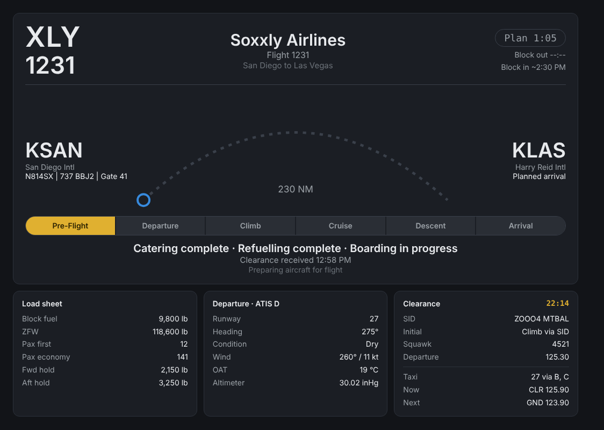
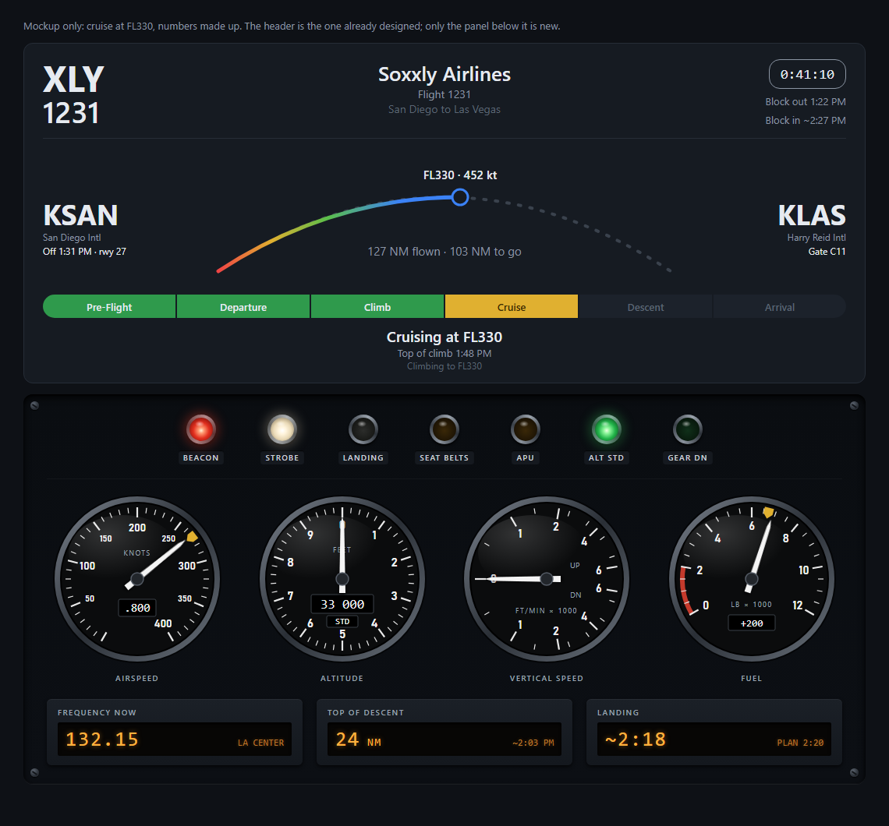

# The dashboard (after the MVP)

The design for the **Live Flight Screen**, called **the dashboard** for short, from the brainstorm with Dave on
2026-11-24. It is the first piece of "deepening the live flight" (`roadmap.md`, after the MVP) and replaces today's
three-column Live (D-139) when it's built. Nothing here is built yet. Decisions D-150 to D-154 and D-179; built in milestones 12 and 13 (D-163), checked with replays
(`replay.md`). Nothing on the dashboard reads the wall clock (D-166).

Only the header, the pre-flight panel and the cruise draft are designed. The panels for departure, climb, descent,
short final and arrival are for later brainstorms.

## Names (D-150)

- **Flight Summary:** the page for a finished flight. It's what Flights shows for a past flight, and what the dashboard
  shows below its header once a flight blocks in.
- **Dashboard (Live Flight Screen):** what Dave looks at in the sim while flying. Today's Live page.
- **Pre-Flight:** the first stage's new name (was Pre-Departure, `design.md` section 13.5).

## The idea

Once Dave is in the sim, he never has to click BlockTime again. The dashboard changes by itself with the phase of
flight, so it always shows what he needs at that moment. The top card (the header) is always there; the panel under
it changes by phase.




The pictures are sketches: the numbers are made up and the colours aren't `Theme.qml`'s.

## The header (D-151)

One card across the top, in this order.

**1. Identity row, three columns.**
- **Left:** the airline's ICAO code (`XLY`) very large, the flight number (`1231`) under it, the same size or a little
  smaller. The ICAO code is larger than the airport codes.
- **Middle (the wide column), centred:** the airline name (`Soxxly Airlines`, about the airport codes' size or a
  little smaller), then `Flight 1231` in a lighter grey, then the cities: `San Diego to Las Vegas`. No callsign.
- **Right:** the block clock as a pill, then `Block out` and `Block in` in local time.
  - Block clock: the plan's block time before block out (`Plan 1:05`, greyed), a running clock from block out, the
    final block time at block in.
  - `Block out --:--` until block out, then the real time. No estimate before it.
  - `Block in ~2:30 PM`, an estimate (with `~`) until block in. Before block out it's the plan's; in flight it comes
    from the predictions (D-120) and updates as the flight goes on; at block in it's the real time.

**2. A thin horizontal line** under the identity row (Claude's call, confirmed by Dave: it separates who the flight is from
the flight happening; the arc and the pill below it stay one unit).

**3. The route arc.** The origin on the left, the destination on the right, joined by a large upward arc.
- Each end: a large departure or arrival icon, the ICAO code in large letters, the airport name much smaller under it,
  then one line that changes:
  - **Origin**, before block out: the airplane and where it's parked, `N814SX | 737 BBJ2 | Gate 41`. After takeoff:
    `Off 1:31 PM · rwy 27`.
  - **Destination:** the arrival gate once known (`Gate C11`, section 13.6). The arrival time is in the header's right
    column, so it isn't repeated here.
- The arc is a progress bar. A marker moves along it by **distance flown along the planned route** (Claude's call,
  confirmed by Dave), so it always agrees with the distance text. The marker carries only altitude and ground speed
  (`FL330 · 452 kt`); `127 NM flown · 103 NM to go` sits under the arc's middle, so labels never collide with the
  airport blocks near the ends.
- The flown part of the arc is coloured by altitude, fading smoothly (not in bands): red near the ground, through
  yellow and green, to blue at cruise, and back down. The part still to fly is a dashed grey line. (This is the
  "altitude-coloured track" idea from `roadmap.md`, on the arc.)
- A small tick could mark top of descent on the arc (sketched once; not settled).

**4. The phase pill.** A large pill-shaped bar across the full width, one section per stage: Pre-Flight, Departure,
Climb, Cruise, Descent, Arrival.
- Grey until the stage starts, yellow while it's in progress, green once it's done.
- Sections are about equal in width, not proportional to time, so Cruise doesn't swallow the bar (Claude's call,
  confirmed by Dave).
- Smaller divisions inside a section are the recorder's phases (pushback, taxi out, takeoff under Departure, and so
  on), a fixed set so the bar never changes shape. Sub-events that come and go (GSX services, level-offs) are in the
  status lines, not the bar (Claude's call, confirmed by Dave).
- The block clock is no longer at the pill's right end; it moved to the header's right column, so the pill keeps its
  full width.

**5. The status lines** under the pill, centred on it (D-152).

## The status lines (D-152)

Three lines, centred under the pill:
1. **The current line**, white and largest.
2. **The previous line**, smaller and light grey, with the time it happened where it has one.
3. **The one before that**, smaller still and darker grey.

When a new line arrives, the others move down one and the oldest drops off. Times are Dave's local time. The event
log stays out of the dashboard (it's in the flight log and, later, behind a developer mode).

**Pre-Flight**
- Starts as `Preparing aircraft for flight`. That covers flying with or without GSX: Dave can enter payload and fuel
  in the FMC himself and skip GSX entirely.
- When a GSX service is requested, the current line becomes the GSX line. **All GSX services running at the same time
  share one line**, so it never flickers through `Catering… Refuelling… Boarding…`:
  `Catering in progress · Refuelling in progress`, then `Catering complete · Refuelling complete · Boarding in
  progress`, and so on. Each part changes in place; the line only shifts down when the next stage starts.
- `Preparing aircraft for flight` or the GSX line stays the current line until block out.

**From block out:**
`Pushback and startup` (the procedure: engines start during the push) → `Taxiing to runway 27` → `Departed runway
27` → `Climbing to FL370` → `Cruising at FL370` → … The full list, settled for milestone 12, is in "Every status line"
below.

- **Level-offs interrupt the climb line.** `Level at FL240` replaces `Climbing to FL370` while level, then the climb
  line comes back. The target level is the SimBrief plan's cruise level, even if ATC holds Dave lower.
- The takeoff roll has no event of its own, but the recorder's `takeoff` phase is one: it's logged once the takeoff is
  confirmed and timed back to where the roll began.

**At block in** (D-154): the line always becomes `Parked at gate C11`. It changes to `Deboarding in progress` only if
Dave starts GSX deboarding, then to `Ready for next flight` (D-135's "ready for shutdown or turnaround", reworded).
Until then the shutdown checklist (engines off, parking brake set, beacon off, strobes off; D-135) sits under the
status lines (D-180).

## Milestone 12: how the header is built (D-180 to D-182)

Milestone 12 builds the header and status lines above; the panels below the header come later in the instrument
panel look (D-179). Claude's calls here were approved by Dave with the design on 2026-11-25.

### What Live looks like after milestone 12 (D-180, Dave)

```
┌ header: identity row · line · route arc · phase pill · status lines (· shutdown checklist) ┐
└────────────────────────────────────────────────────────────────────────────────────────────┘
┌ planned flight (at the gate)            ┐ ┌ event ┐
│   or the Flight Summary (after block in)│ │ feed  │
├─────────────────────────────────────────┤ │       │
│ flight tiles (today's flight panel)     │ │       │
└─────────────────────────────────────────┘ └───────┘
```

- The header shows while there's a planned flight, an open flight or a flight summary; with nothing planned, Live is
  the tiles and the feed as today.
- Today's stages column (`FlightProgress.qml`) goes: the pill and the status lines replace it. Its Ready checklist
  moves under the status lines.
- The event feed stays as a narrow column on the right until developer mode exists (Dave). D-152 still holds for the
  dashboard's design; the feed is a stopgap.
- At block in the Flight Summary takes the planned flight panel's place below the header (D-154); today it sits above
  everything.
- Pre-Departure becomes Pre-Flight everywhere it shows (D-150).
- The replay window's Live is the same page, so replays show the header too.

### Where each value comes from

| Header part | Source |
|---|---|
| `XLY`, `Soxxly Airlines` | the airline configuration (`airline.yaml`) |
| Flight number | the planned flight |
| `San Diego to Las Vegas` | the origin's and destination's **city**, a new airport column filled by `blocktime-import` from OurAirports' `municipality` (D-181); the airport's name when a city is empty |
| Airport names | the airport table, as stored; long names are cut with `…` |
| Block clock | `Plan 1:05` (the plan's block time, greyed) before block out, then the running clock, then the final time |
| `Block out` | `--:--`, then block out's time |
| `Block in ~2:27 PM` | until the predictions (D-120): before block out, now plus the plan's block time; from block out, block out plus the plan's block time; at block in the real time without `~`. No plan: `--:--` |
| Origin line | `N814SX · 737 BBJ2 · Gate 41` (registration, type, where it parked, D-148) until liftoff, then `Off 1:31 PM · rwy 27` from the `liftoff` event |
| Destination line | the `arrival_gate` event's gate once known (`Gate C11`), else empty |
| Marker | the latest sample's altitude and ground speed (`FL330 · 452 kt`, `8,500 ft · 250 kt`) |
| `127 NM flown · 103 NM to go` | route progress, below |
| Pill | the six stages and the current phase |
| Status lines | a new plain C++ class fed the same events as the stages, below |

Altitudes read as flight levels at and above the origin's transition altitude while climbing and cruising, and above
the destination's transition level in the descent (both from the plan; 18,000 ft without one), else as feet. Lines
from an event with the recorder's `flight_level` flag use the flag; the marker and `Climbing to FL370` have no flag,
so the app applies the same rule as `FlightTracker::flightLevel`, shared as one plain function.

**After block in** the planned flight models hold no flight (they clear it at settling), but the header still needs the
flight number, cities, plan and navlog. It reads them from the settled flight (`flownFlightView`, extended to carry the
stored OFP's navlog), as the replay already does.

**The arrival gate's name** follows the stages' rule (`arrivalGateText`): BlockTime's spot when it `assigned` one or
it's `unconfirmed`, otherwise SayIntentions' gate, shown as the name reads (`Gate C11`, `Terminal A Gate 4`, `Parking
70`). At block in, the spot Dave actually parked at (`block_in`'s `parking`) replaces it (Claude's call).

### Route progress (D-182)

- **The route** is a line through the origin airport, every fix in the stored SimBrief plan's navlog (`pos_lat`,
  `pos_long`; the plan is kept verbatim, so nothing is fetched) and the destination airport. Without a plan it's the
  straight line between the airports.
- **Distance flown** is the latest position projected onto that line, searching forward from the last matched leg so a
  SID or STAR that doubles back can't jump the marker, and never going down. It stays 0 until liftoff and becomes the
  whole route at block in. "To go" is the route's length minus that, so the two always add up. Whole NM.
- **The arc's colours:** the highest altitude seen in each 1% of the route is kept, from the samples. Each piece of the
  flown arc takes its colour from that altitude as a share of the plan's cruise altitude (35,000 ft without a plan):
  red at the ground, yellow at about a third, green at about two thirds, blue at cruise, blending smoothly. The arc is
  drawn as short segments and redrawn only when a piece changes.
- The top-of-descent tick waits for the predictions (D-120).

### The pill's divisions (D-182)

A fixed set: Pre-Flight, Climb, Cruise and Arrival have none; Departure has pushback, taxi out and takeoff; Descent has
descent, approach, landing and taxi in (a go-around counts as approach). Inside the current stage, finished divisions
are green, the current one yellow and the rest grey, so the bar shows progress through Departure and Descent too.

### Every status line (D-182)

| When | Current line |
|---|---|
| A planned flight at the gate, no GSX service yet | `Preparing aircraft for flight` |
| A GSX service starts or finishes, before block out | `Catering complete · Refuelling in progress`: every service of this leg so far, changing in place. It starts when GSX is performing the service, as `GsxTimeline` counts it; a request alone changes nothing (Claude's call) |
| Phase pushback | `Pushback and startup` |
| Phase taxi out | `Taxiing to runway 27` (the departure runway Live shows: the ATIS's, else the plan's; `Taxiing to runway` without one) |
| Phase takeoff | `Takeoff roll` |
| `liftoff` | `Departed runway 27` |
| Phase climb | `Climbing to FL370` (the plan's cruise level; `Climbing` without a plan) |
| `level_off` in the climb, descent, approach or go-around | `Level at FL240`, in place of the current line; `level_off_ended` puts that line back, also in place |
| Phase cruise | `Cruising at FL370` |
| `step_climb`, then its end | `Step climb` (the event knows only the level it left), then `Cruising at FL390` in place; a step down reads `Step descent`, then `Cruising at FL350` |
| Phase descent | `Descending into Las Vegas` (the destination's city) |
| Phase approach | `Approach into Las Vegas` |
| Final approach (the event the stages' `Final approach, runway …` line uses) | `Final approach, runway 26L` |
| Phase go-around | `Go-around` |
| `touchdown` | `Landed on runway 26L` (the final approach's runway; `Landed` without one) |
| `landing_runway` | corrects that line's runway in place, wherever it now is: in the recorded flights it comes with taxi in, after it |
| Phase taxi in | `Taxiing to gate C11` (the arrival gate; `Taxiing to gate` without one) |
| `block_in` | `Parked at Gate C11` (block in's spot as it reads; `Parked` without one), with the shutdown checklist under the lines |
| GSX deboarding | `Deboarding in progress`, then `Deboarding complete`, in place |
| Ready (D-135, unchanged: deboarding completes, or without GSX the checks pass) | `Ready for next flight` |

- The shutdown checklist (engines off, parking brake set, deboarding complete when GSX deboarded, beacon off, strobes
  off) shows from block in until the summary is dismissed, ticking as items pass, so a beacon left on after Ready is
  still visible (Claude's call; D-135's trigger for Ready is unchanged).

- The previous lines show the local time they started: `Climbing to FL330 · 1:33 PM`.
- A line that changes in place (GSX, level-offs, deboarding) doesn't push the others down.
- Markers (10,000 ft, transition altitude, 200 nm out) don't become status lines; they're in the feed.

### Testing

No fixture has a navlog yet: copy a real OFP from Dave's database (`flight_simbrief_plan.ofp_json`) into `tests/data/`,
cut down to the fields BlockTime reads and with his SimBrief user details removed, and note the navlog's fields in
`notes/simbrief-api.md`.

Plain C++ with tests first: reading the navlog, route progress, the altitude pieces and their colours, the status lines
(from the recorded flights in `tests/data/` and made-up events), the header's texts and times, and migration 9 with the
import's city. Then Live is checked on Dave's real flights with `--replay last --at … --grab` at the gate, in taxi, in
a climb level-off, in cruise, on final and at block in, and with `--demo`. No sim test.

### Left to the builder

Sizes, fonts and colours (all in `Theme.qml`), the departure and arrival icons (Segoe Fluent Icons), class and file
names, how the header shrinks on a short window, and the airplane type's short name in the origin line.

## The instrument panel look (D-179)

Everything below the header is drawn as an **inset instrument panel**: recessed into the page, darker than the cards
around it, with small screw heads in its corners. The header itself stays flat. Dave has the real gauges, switches and
lights in the sim, so the dashboard isn't there to repeat numbers: it has to be fun to look at. Numbers in flat cards
were fine for the MVP and are lifeless after it.



A sketch with made-up numbers; the HTML it was drawn from is `images/dashboard-instrument-panel.html`.

- **Steam gauges** for values that move: airspeed (with the Mach number in a small window), altitude (a pointer for
  hundreds, a counter, the altimeter setting in a small window), vertical speed, fuel (with a red low-fuel arc). Black
  faces, white ticks and needles, a metal bezel, a faint glare on the glass.
- **Indicator lamps** for what the debrief's checks score (`debrief.md` section 2): beacon, strobes, landing lights,
  seat belts, APU, altimeters on STD, gear down. Each is a small domed glass button in a metal ring with an
  incandescent bulb behind it: a warm glow when lit, dark tinted glass when off, an engraved placard under it. The
  recorder already logs all of them (`beacon` and `strobe` in telemetry, the rest in the `cockpit` event).
- Claude's calls (confirmed by Dave, 2026-11-25):
  - Each lamp has its own lens colour: beacon red, strobes and landing lights white, seat belts and APU amber,
    STD and gear green.
  - A small amber **bug** on a gauge marks the plan's value (cruise speed, planned fuel now).
  - Numbers that aren't natural dials (frequency, top of descent, landing time) are **radio-stack readouts**: amber
    digits glowing in a dark window.
  - A needle **glides** briefly to each new value (telemetry comes at most once a second, so it would otherwise jump)
    and is still between changes: no continuous animation (budget under 1% CPU).
- Open, for the panels' brainstorm: whether a lit lamp means only "switch on", or also warns when the switch is wrong
  for the moment (landing lights off below 10,000 ft); which gauges and lamps each phase's panel shows; how the
  Pre-Flight panel's load sheet and clearance (D-153) take the look (a transponder-style squawk, radio-stack
  frequencies).
- Every colour and size goes in `Theme.qml` like the rest (D-054).

## Below the header, by phase

### Pre-Flight panel (D-153)

Everything Dave needs to set up the aircraft at the gate, so BlockTime is the only window open beside the sim until
pushback (D-118). Takeoff performance still comes from the PMDG EFB; the dashboard shows its inputs and calculates
nothing. All weights in pounds. No centre of gravity.

**Load sheet** (from the SimBrief plan and the configuration's seats and holds, `design.md` section 17)
- **Block fuel:** the total that should be on board (what goes into the FMC), not the amount to add.
- **Zero fuel weight.**
- **Passengers**, split by class when the airplane has more than one.
- **Cargo**, split into the holds at the configuration's ratios, summing to SimBrief's cargo figure. A freighter shows
  only the cargo.
- Claude's suggestion, not yet agreed: a small line with the other FMC inputs from the plan (flight number for the RTE
  page, cost index, cruise level, reserves, transition altitude), useful when the plan isn't uplinked.

**Departure** (the EFB's inputs; ATIS polled about every 5 minutes, D-118)
- **Runway:** the plan's at first, then the ATIS's from SayIntentions, which may differ. When it differs from the plan,
  say so (the plan's SID may be wrong too).
- Runway **heading** and runway **condition**.
- **Wind** and **outside air temperature** at the origin.
- **Altimeter** in the unit the ATIS gives (inHg in the US, hPa elsewhere).

**Clearance** (once SayIntentions gives the pre-departure clearance)
- **SID:** SayIntentions leaves off the transition, so match its SID name against the plan's and show the plan's full
  form: SayIntentions says `via the ZOOO4 departure`, the plan has `ZOOO4 MTBAL`, the dashboard shows `ZOOO4 MTBAL`.
  If SayIntentions gives a SID the plan doesn't have, show it and mark it as changed (reprogram the FMC).
- **Initial altitude:** `4,000 ft` or `Climb via SID`.
- **Squawk** (Claude's addition: needed before pushback).
- **Departure frequency** from the clearance (Claude's addition; it can differ from the published list).
- **Taxi route**, once ground gives it.
- **A 30-minute countdown** from the clearance, for when it expires. It disappears at block out. (Claude's suggestion:
  amber, then red in the last 5 minutes.)

**Frequencies, all flight long.** Always the frequency Dave should be on now and the one he'll need next: clearance and
ground at the gate, ground and tower after block out, and so on.

### Cruise (draft)

Altitude, ground speed (with IAS), top of descent (distance and local time), fuel against plan, the frequency now, and
landing time against plan. A draft only; the in-flight panels are for a later brainstorm. First sketched as data cards,
then in the instrument panel look (D-179, sketch above).

### After block in (D-154)

The header stays, filled in (real block in time, final block time, the whole arc coloured, every stage green or
Arrival in progress), with the status lines above. The panel below changes to the **Flight Summary**. Today the whole
page switches to the summary at block in (D-134, `design.md` section 13.7); this keeps the header in place instead.

## Open before building

- **What SayIntentions exposes.** Found 2026-11-24 (D-163): the clearance and the taxi routes are already in the
  logged `atc_exchange` lines (KLAS: "Cleared to San Diego via the RADYR2 departure. Then as filed. Climb via the SID.
  Expect FL360 one-zero minutes after departure. Departure on 125.9. Squawk 2546. Expect runway 8L"), so the clearance
  card reads them from there, as spoken text. Still open: the published frequencies.
  Earlier note: the clearance (SID, initial altitude, squawk, departure frequency), the taxi route
  and the frequencies are only useful if BlockTime can read them. `notes/sayintentions-api.md`: the local
  `flightJSON` already has `atc_exchange` messages, routes and the arrival ATIS, but nothing confirmed for the
  clearance or frequencies. Needs a probe flight before the clearance card is promised. Fallback for published
  frequencies (clearance, ground, tower): OurAirports' frequency file; departure and center frequencies would then
  only come from ATC.
- The panels for departure, climb, descent, short final and arrival.
- The final wording of every status line (a later brainstorm, with the recorder's events in hand).
- How it fits on Dave's screen at the gate: if the header pushes the pre-flight cards below the fold, the arc could
  shrink before block out.
- Docs to change when it's built: `design.md` section 13.5 (stage name, the progress card) and 13.7 (block in), and
  D-134, D-135 and D-139, which these supersede in part.
