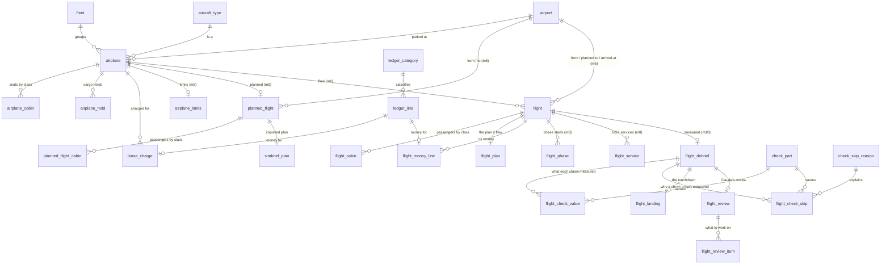

# The airline database

The schema of `%LOCALAPPDATA%\BlockTime\blocktime.db`, the one SQLite file that holds the airline (design.md §2).
It follows the database rules in `CLAUDE.md` (D-078), applied for what they protect (D-090). Keep this file true: a
schema change updates it in the same commit.

**Status:** built through milestone 8 (schema version 5, `src/airline_db.cpp`).

## Conventions

| What | How |
|---|---|
| Tables | `STRICT`. Every column `NOT NULL` unless empty has a clear meaning, stated with the column. |
| Keys | `INTEGER PRIMARY KEY` surrogate ids named `<table>_id`. Natural identifiers get `UNIQUE`. |
| Relations | Foreign keys with an explicit `ON DELETE`. `PRAGMA foreign_keys = ON` on every connection. Every foreign key column has an index (a primary key or `UNIQUE` that starts with the column counts). |
| Times (D-081) | UTC instants as `TEXT` `YYYY-MM-DDTHH:MM:SSZ`, whole seconds, the same shape as the event log without the milliseconds. A `CHECK` enforces the shape. Calendar dates (a lease start) as `TEXT` `YYYY-MM-DD`. Both sort correctly as text. |
| Money | `INTEGER` cents, always a multiple of 500 (every line rounded to $5 when posted, D-080). |
| Weights | `INTEGER` pounds. |
| Booleans | `INTEGER` with `CHECK (x IN (0, 1))`. |
| Coordinates | `REAL` degrees, with range checks. |
| History | Ledger lines and flights are written once and never updated or deleted. A correction is a new, reversing line. |
| Changes | Anything that touches several tables (leasing an airplane, a month's lease charges) runs in one transaction. |
| Migrations | Numbered, each in a transaction, tracked with `PRAGMA user_version`. Tests build an empty database through every migration. |

Connection settings: `foreign_keys = ON`, `journal_mode = WAL` (the UI can read while the airline writes),
`synchronous = FULL` (money is never lost to a power cut; the cost is a few milliseconds per transaction).

**What the schema guards, and what tests guard (D-090).** The schema enforces what protects against real bugs:
relations between real entities, unique registrations and ICAO codes, money in $5 steps, and a lease month never
charged twice. Values written by a single, validated code path (an airplane's cabins and holds, copied from the
catalog when it's leased) are checked by that code and its tests, not by extra tables or triggers.

**Template copied at lease time (D-082, D-091).** The catalog YAML holds **airframes**: templates, each a type in one
configuration (737-800 two-class). An **airplane** is one leased plane made from an airframe, like an object made
from a class. When an airplane is leased, its airframe's values (seats, holds, the type's lease rate) are copied into
the database with it. Types themselves are reference data, refreshed from the catalog (D-093). From then on the database
is the source of truth: editing the catalog changes future leases, never airplanes already in the fleet.

## Entity diagram

## Tables

### The airline itself: no table

The airline's name, ICAO code and callsign live only in `airline.yaml` and are read from it on every start. They
have no history behind them, so a database copy would only repeat the config (D-093). They get a table when the
settings screen moves them into the app (D-092). Starting cash is posted once, as an `opening_cash` ledger line.

### `fleet`

Named groups of airplanes (design.md §6).

| Column | Type | Rules |
|---|---|---|
| `fleet_id` | INTEGER PK | |
| `name` | TEXT | `UNIQUE`, not empty |

### `aircraft_type`

What a plane is (737-800, 737-800 BBJ2, 777F). Reference data: every type in the catalog is written here at each
start, and edits to a type in the catalog update its row (D-093). Terms of a lease (rate, seats, holds) are copied
onto each airplane instead, so a catalog edit never changes an airplane already leased (D-082).

| Column | Type | Rules |
|---|---|---|
| `aircraft_type_id` | INTEGER PK | |
| `code` | TEXT | `UNIQUE` (`737-800`, `737-800 BBJ2`) |
| `family` | TEXT | `CHECK (family IN ('737', '777'))`; fixed by D-039. Rotations (D-075) and costs depend on it. |
| `role` | TEXT | `CHECK (role IN ('airliner', 'executive', 'freighter'))`. Decides the kind of flight (design.md §13.1): an airliner flies passengers and can carry belly cargo (D-089); an executive jet (the BBJ2) flies VIP or charter, never with belly cargo; a freighter flies cargo. |
| `turnaround_min` | INTEGER | > 0 (35 for 737s, 60 for 777s) |
| `cruise_speed_kt` | INTEGER | > 0, for previews |
| `sim_folder` | TEXT | added in schema 4 (D-112): the folder of the variant's `aircraft.cfg` in the sim (`PMDG 737-800BBJ2`), for the matching check (D-088). Written from the catalog at every start, so the column's default `''` never outlives a start |

### `airplane`

One leased plane, its lease terms, and where it is now.

| Column | Type | Rules |
|---|---|---|
| `airplane_id` | INTEGER PK | |
| `registration` | TEXT | `UNIQUE`; capitals, digits and `-`. Entered by Dave in `airline.yaml` when leasing, and set by him in the airplane's SimBrief profile (D-087). Not read from the sim: a livery's ATC ID won't match every registration |
| `tail_number` | TEXT NULL | optional (design.md §3); NULL means the airplane has none. `CHECK` not empty when set |
| `aircraft_type_id` | INTEGER | FK → `aircraft_type`, `ON DELETE RESTRICT` |
| `fleet_id` | INTEGER | FK → `fleet`, `ON DELETE RESTRICT` |
| `airframe_name` | TEXT | the catalog airframe it was made from (`737-800 Two-class`), for display |
| `simbrief_airframe_id` | TEXT | `UNIQUE`; entered per airplane in `airline.yaml`, since each airplane has its own custom SimBrief airframe carrying its registration (D-087). Not part of the catalog template |
| `leased_on` | TEXT | calendar date; each lease month starts on this day of the month |
| `monthly_lease_cents` | INTEGER | > 0, multiple of 500; the rate at lease time, kept for the life of the lease |
| `location_airport_id` | INTEGER | FK → `airport`, `ON DELETE RESTRICT`; **current state**, moves after each flight |
| `fuel_on_board_lb` | INTEGER | ≥ 0; **current state** (design.md §11, fuel stays in the tanks) |
| `awaiting_delivery` | INTEGER | boolean; **current state**: 1 until the factory delivery flight is settled (milestone 6) |
| `free_flight_number` | TEXT NULL | added in schema 3 (D-106): the default flight number of its free flights, 1–4 digits, unique (a unique index; several NULLs are allowed). NULL means none is set, and New Flight's field starts empty. Set from `airline.yaml` at every start |
| `returned_on` | TEXT NULL | calendar date the lease ended; NULL while the airplane is still leased |
| `return_reason` | TEXT NULL | `CHECK (return_reason IN ('unpaid'))`; set together with `returned_on` (`CHECK ((returned_on IS NULL) = (return_reason IS NULL))`). `'returned'` (Dave returns it, with a prorated refund) comes with the settings screen |

Indexes: `aircraft_type_id`, `fleet_id`, `location_airport_id` (New Flight lists what's parked at an airport).

An airplane is **in the fleet** while `returned_on` is NULL. A returned airplane stays in the database: its lease
charges (and later its flights) point at it.

The current-state columns, and `returned_on` and `return_reason` once, are the only columns in the database that are
ever updated. Everything that changes them (a settled flight, an unpaid month) also writes the facts behind the
change.

One airplane row is one lease. Leasing the same registration again after a return isn't supported in the MVP.

### `airplane_cabin`

Seats per cabin class. Airliners and executive jets have rows; freighters have none (the lease code copies cabins
only for those roles, and a test checks it).

| Column | Type | Rules |
|---|---|---|
| `airplane_id` | INTEGER | FK → `airplane`, `ON DELETE CASCADE` |
| `cabin_class` | TEXT | `CHECK (cabin_class IN ('economy', 'business', 'first'))` |
| `seats` | INTEGER | > 0 |

Primary key `(airplane_id, cabin_class)`.

### `airplane_hold`

Cargo holds, for every airplane (bags and belly cargo on airliners, bags on the BBJ2, cargo on freighters).

| Column | Type | Rules |
|---|---|---|
| `airplane_id` | INTEGER | FK → `airplane`, `ON DELETE CASCADE` |
| `hold` | TEXT | `CHECK (hold IN ('forward', 'aft', 'bulk', 'main_deck'))` |
| `max_lb` | INTEGER | > 0 |
| `ratio` | INTEGER | > 0; the hold's share of the split (4 and 5 for the 737's 4:5) |

Primary key `(airplane_id, hold)`.

### `ledger_category`

What a money line is for. A lookup table rather than a `CHECK`, because the list grows with each milestone (flight
income and each cost item in milestone 6), and SQLite can't change a `CHECK` without rebuilding the table.

| Column | Type | Rules |
|---|---|---|
| `code` | TEXT PK | stable natural key: `opening_cash`, `lease` (milestone 4) |
| `label` | TEXT | shown on the money screen |

### `ledger_line`

Every money movement. Cash is the sum of all lines; it isn't stored anywhere else, so it can't disagree with them.

| Column | Type | Rules |
|---|---|---|
| `ledger_line_id` | INTEGER PK | |
| `category` | TEXT | FK → `ledger_category`, `ON DELETE RESTRICT`; indexed |
| `posted_at` | TEXT | UTC instant: when the money moved in airline time (a lease charge's due date, even if the app was closed then) |
| `amount_cents` | INTEGER | multiple of 500, not 0; income positive, costs negative |

Indexes: `posted_at` (the money screen lists lines newest first). A partial unique index
`ON ledger_line (category) WHERE category = 'opening_cash'`: starting cash can only be posted once.

### `lease_charge`

One lease month charged for one airplane. It's its own fact, and it has a money line.

| Column | Type | Rules |
|---|---|---|
| `ledger_line_id` | INTEGER PK | FK → `ledger_line`, `ON DELETE RESTRICT` |
| `airplane_id` | INTEGER | FK → `airplane`, `ON DELETE RESTRICT` |
| `period_start` | TEXT | calendar date |

**`UNIQUE (airplane_id, period_start)`**: a month can never be charged twice, even if the app crashes mid-catch-up.
The money screen builds each line's text from it ("Lease N738BT, 22 Nov – 21 Dec"), so no description column
duplicates the data. Flight money lines in milestone 6 follow the same shape: each cost item points at its line.

### `airport` and `airport_import`

Imported from OurAirports, joined with an airport time zone dataset on the ICAO code (D-079, D-084).

`airport`:

| Column | Type | Rules |
|---|---|---|
| `airport_id` | INTEGER PK | |
| `icao_code` | TEXT | `UNIQUE`, 4 capitals/digits |
| `name` | TEXT | |
| `latitude` | REAL | −90..90 |
| `longitude` | REAL | −180..180 |
| `elevation_ft` | INTEGER | |
| `country_code` | TEXT | ISO 3166-1 alpha-2 |
| `time_zone` | TEXT | IANA name (`America/Los_Angeles`); airports without one aren't imported |
| `longest_runway_ft` | INTEGER | > 0; the longest open, paved runway. New Flight's runway check (design.md §4) compares the airplane's minimum runway with it. Runway layouts for phases and gates come from the sim (D-074, D-079) |

`airport_import`, a log of imports so the app can say when the data was last refreshed: `airport_import_id` PK,
`imported_at` UTC instant, `airport_count`. A refresh updates airports by ICAO code and adds new ones. Airplanes point
at airports, so none is ever deleted; one that drops out of the source keeps its last values.

**Import filter (D-094):** OurAirports types `large_airport` and `medium_airport`, not closed, with a 4-character
ICAO code, at least one open paved runway of 4,000 ft or more, and a time zone in the dataset. The first real import
(2026-11-23) kept 4,265 of 86,383 airports, in a 512 KB database. Details in `docs/notes/airport-data.md`.

## Milestone 4's processes

**Types from the catalog (D-093).** At each start, every type in the catalog is inserted or updated in
`aircraft_type`, before any leasing.

**Leasing from config (D-082, D-083).** At each start, every airplane in `airline.yaml` whose registration isn't in
the database is leased, in one transaction: take the registration and SimBrief airframe from `airline.yaml`, copy
its airframe from the catalog, insert the airplane with its cabins and holds, and charge the first
month. If cash is less than that month's charge, nothing is written and the Fleet screen shows "Can't afford
N738BT's first month". Affordability is the cash as of `leased_on` (D-096), so a later start gives the same answer:
set a later `leased_on` to try again. An airplane whose SimBrief airframe already belongs to a leased airplane (a
registration renamed in the config) isn't leased, and the notice says why. One airplane that can't be leased never
stops the other airplanes' months from being charged (D-098). Editing or removing an airplane already leased changes
nothing in the database (a warning in `errors.log`).

**Monthly lease charges.** At start and every minute while open: for every airplane in the fleet, every lease month
whose start has passed and has no `lease_charge` row is charged, all airplanes together in date order, each line
posted at its own due date. If cash is less than a month's charge, the airplane is returned instead
(`returned_on` set, reason `unpaid`) and its later months aren't charged. A lease month starts on the `leased_on`
day each month, or the month's last day if it's shorter (leased 31 Jan → 28 Feb, then 31 Mar).

**The old test database.** A `blocktime.db` with `user_version` 1 is the Qt test's (D-061). It's renamed to
`blocktime.test-schema.db` (kept, not deleted) and a new file is built through the migrations. The real schema's
first migration is number 2, so the two can never be confused. BlockTime 0.4 and older set `user_version` to 1 on
any `blocktime.db` they opened, so a version-1 file that has an `airplane` table is a real airline: its version is put
back and a notice says so (D-098).

**Concurrency.** The app and `blocktime-import` may both have the file open. Every connection waits up to 5 s for a
lock (`busy_timeout`), and a transaction that can't begin writes nothing (D-098).

## Milestone 5's tables (schema version 3)

Migration 3 adds four tables and one column, `airplane.free_flight_number` (D-106, in the `airplane` table above).

### `airplane_limits`

The values New Flight needs before a SimBrief plan exists (D-100): the airframe's defaults from the catalog, with any
override from `airline.yaml`, copied when the airplane is leased. A separate table rather than new `airplane`
columns because SQLite can only add a `NOT NULL` column with a default, and there's no right default for an airplane
already leased: such an airplane gets its row at the next start, from its airframe. Until then it has no row, and New
Flight says so.

| Column | Type | Rules |
|---|---|---|
| `airplane_id` | INTEGER PK | FK → `airplane`, `ON DELETE CASCADE` |
| `min_runway_ft` | INTEGER | > 0; compared with the destination's `longest_runway_ft` |
| `mlw_lb` | INTEGER | > 0; the landing fee (design.md §11) and the landing-weight warning |
| `passenger_weight_lb` | INTEGER | > 0; to cap cargo at max payload |
| `bag_weight_lb` | INTEGER | ≥ 0; bags per passenger |
| `max_payload_lb` | INTEGER | > 0; MZFW − empty weight |

### `planned_flight`

The flight set up in New Flight and not flown yet (D-103). **Current state, not history:** Cancel flight deletes it,
and milestone 6 turns a flown one into a `flight`. One at a time, which the app checks (New Flight is disabled while
one exists); `UNIQUE (airplane_id)` is the part the schema can say.

| Column | Type | Rules |
|---|---|---|
| `planned_flight_id` | INTEGER PK | |
| `airplane_id` | INTEGER | `UNIQUE`; FK → `airplane`, `ON DELETE RESTRICT` |
| `origin_airport_id` | INTEGER | FK → `airport`, `ON DELETE RESTRICT`; indexed. Where the airplane was parked when the flight was planned |
| `destination_airport_id` | INTEGER | FK → `airport`, `ON DELETE RESTRICT`; indexed. `CHECK (destination_airport_id <> origin_airport_id)` |
| `flight_number` | TEXT | 1–4 digits (D-102) |
| `kind` | TEXT | `CHECK (kind IN ('passenger', 'vip', 'charter', 'cargo', 'delivery'))` (design.md §13.1) |
| `cargo_lb` | INTEGER | ≥ 0; belly cargo on a passenger flight, or a freighter's load. `CHECK (cargo_lb = 0 OR kind IN ('passenger', 'cargo'))`. 0 on a passenger flight means belly cargo wasn't chosen |
| `fuel_price_cents_per_100lb` | INTEGER | > 0; locked when planned (design.md §11) |
| `planned_at` | TEXT | UTC instant Dave pressed Plan flight; an imported OFP must be generated after it (D-105) |
| `origin_runway` | TEXT NULL | from the origin's ATIS; NULL means none was found and SimBrief chose |
| `destination_runway` | TEXT NULL | from the destination's ATIS; NULL as above |

Bags (passengers × bag weight) and the weight per hold (the bags and cargo split by the airplane's hold ratios,
design.md §9) aren't stored: they follow from what is.

### `planned_flight_cabin`

Passengers rolled per cabin class (design.md §9). A delivery or freighter flight has no rows.

| Column | Type | Rules |
|---|---|---|
| `planned_flight_id` | INTEGER | FK → `planned_flight`, `ON DELETE CASCADE` |
| `cabin_class` | TEXT | `CHECK (cabin_class IN ('economy', 'business', 'first'))` |
| `passengers` | INTEGER | ≥ 0 |

Primary key `(planned_flight_id, cabin_class)`.

### `simbrief_plan`

The imported SimBrief plan (D-101). The OFP's JSON is kept verbatim (the allowed source-document copy, D-078), next
to the fields the app uses, taken from it at import. Importing again replaces the row.

| Column | Type | Rules |
|---|---|---|
| `planned_flight_id` | INTEGER PK | FK → `planned_flight`, `ON DELETE CASCADE` |
| `request_id` | TEXT | SimBrief's id for this OFP (`params.request_id`) |
| `generated_at` | TEXT | UTC instant (`params.time_generated`) |
| `imported_at` | TEXT | UTC instant |
| `route` | TEXT | `general.route`, for the copy button |
| `origin_runway`, `destination_runway` | TEXT | `origin.plan_rwy`, `destination.plan_rwy` |
| `cruise_altitude_ft` | INTEGER | > 0; `general.initial_altitude` |
| `est_block_s` | INTEGER | > 0; `times.est_block` (`HH:MM:SS` in the OFP) |
| `ramp_fuel_lb` | INTEGER | > 0; `fuel.plan_ramp` |
| `enroute_burn_lb` | INTEGER | > 0; `fuel.enroute_burn` |
| `est_landing_weight_lb` | INTEGER | > 0; `weights.est_ldw` |
| `origin_transition_altitude_ft` | INTEGER | > 0; `origin.trans_alt`, for milestone 7 |
| `destination_transition_level_ft` | INTEGER | > 0; `destination.trans_level` (feet), for milestone 7 |
| `ofp_json` | TEXT | the whole OFP as fetched |

## Milestone 5's processes

**Limits at lease time (D-100).** Leasing copies the airframe's `limits` from the catalog, each value replaced by
the airplane's override in `airline.yaml` if it has one, in the same transaction as the airplane. At each start, an
airplane with no `airplane_limits` row gets one the same way.

**Free-flight numbers (D-106).** At every start, each airplane's `free_flight_number` is set from `airline.yaml`'s
`flight_number` (cleared first, in one transaction, so two airplanes can swap numbers). A planned flight keeps its own
`flight_number`, so changing the default changes nothing already planned.

**Planning (design.md §13.1–13.2).** Plan flight writes `planned_flight` and its cabins in one transaction, after the
ATIS runways are fetched. Importing a plan writes or replaces `simbrief_plan`. Cancel flight deletes the planned
flight (its cabins and plan go with it).

## Milestone 6's tables (schema version 4)

Migration 4 adds four tables, the column `aircraft_type.sim_folder` (D-112, in the `aircraft_type` table above) and
17 `ledger_category` rows, one per money line a flight can have: `economy_fares`, `business_fares`, `first_fares`,
`vip_fares`, `charter`, `cargo`, `fuel`, `landing_fee`, `gate`, `handling`, `ga_services`, `atc`, `catering`,
`cargo_handling`, `pilots`, `flight_attendants`, `maintenance`. Each is labelled as the preview labels its line.

### `flight`

One settled flight (D-115). **History:** written once, when the flight is settled, and never updated or deleted.
The planned flight it came from is deleted in the same transaction.

| Column | Type | Rules |
|---|---|---|
| `flight_id` | INTEGER PK | |
| `log_flight_id` | TEXT | `UNIQUE`, not empty: the event log's `flight_id` (the block-out time with milliseconds). A flight can't be settled twice (D-113) |
| `airplane_id` | INTEGER | FK → `airplane`, `ON DELETE RESTRICT`; indexed |
| `flight_number` | TEXT | 1–4 digits, as planned |
| `kind` | TEXT | the same `CHECK` as `planned_flight.kind` |
| `origin_airport_id` | INTEGER | FK → `airport`, `ON DELETE RESTRICT`; indexed |
| `planned_destination_airport_id` | INTEGER | FK → `airport`, `ON DELETE RESTRICT`; indexed |
| `arrival_airport_id` | INTEGER | FK → `airport`, `ON DELETE RESTRICT`; indexed. Where it parked: the imported airport nearest the block-in position (D-113). Differs from the planned destination after a diversion |
| `cargo_lb` | INTEGER | ≥ 0; `CHECK (cargo_lb = 0 OR kind IN ('passenger', 'cargo'))` |
| `fuel_price_cents_per_100lb` | INTEGER | > 0; the price locked when it was planned |
| `planned_at` | TEXT | UTC instant |
| `block_out_at`, `block_in_at` | TEXT | UTC instants, whole seconds; `CHECK (block_in_at > block_out_at)`. `block_in_at` is indexed (the Flights list sorts by it) |
| `fuel_on_record_lb` | INTEGER | ≥ 0; the airplane's fuel on board before the flight (design.md §11) |
| `fuel_out_lb` | INTEGER | ≥ 0; at block out |
| `fuel_in_lb` | INTEGER | ≥ 0; when the last engine stopped (`shutdown_fuel_lb`, D-110), the airplane's new fuel on board |
| `origin_runway`, `destination_runway` | TEXT NULL | the ATIS runways, as on `planned_flight`; NULL means none was found |
| `origin_parking`, `arrival_parking` | TEXT NULL | migration 6 (D-148): the parking spot the recorder named at block out and block in ("Gate D14", "Parking 70"); NULL when no spot was within 40 m, the airport's spots weren't loaded, or the flight is from before 0.10.0 |

Not stored, because they follow from the columns (D-114): the block time (`block_in_at − block_out_at`), the fuel
added (`max(0, fuel_out_lb − fuel_on_record_lb)`) and the fuel used (`fuel_out_lb − fuel_in_lb`).

### `flight_cabin`

Passengers per cabin class, copied from `planned_flight_cabin`. Primary key `(flight_id, cabin_class)`.
`flight_id` is FK → `flight`, `ON DELETE CASCADE` (only tests delete flights).

### `flight_plan`

The SimBrief plan the flight flew: a copy of its `simbrief_plan` row, with the same columns, keyed by `flight_id`
(PK, FK → `flight`, `ON DELETE RESTRICT`) in place of `planned_flight_id`. Absent when Dave flew without importing a
plan. A copy rather than one plan table pointed at by both, so each table stays simple (D-115).

### `flight_money_line`

Each money line of a flight. The money itself is a `ledger_line`, as with `lease_charge`.

| Column | Type | Rules |
|---|---|---|
| `ledger_line_id` | INTEGER PK | FK → `ledger_line`, `ON DELETE RESTRICT` |
| `flight_id` | INTEGER | FK → `flight`, `ON DELETE RESTRICT`; indexed |

The line's category says what it's for, and the money screen builds its text from the flight ("XLY8 KBFI–KSAN ·
Fuel").

## Milestone 6's processes

**Settling a flight (D-109, D-113).** The recorder logs `block_out` with the `planned_flight_id` it matched. The app
settles the planned flight when the event log (the last 7 daily files) has such a `block_out`, released after the
flight was planned and not already a `flight`, followed by its `block_in`. An interrupted attempt is skipped, so the
same planned flight can be flown again (D-108). The app looks on every block event and once at startup, so a crash
between block in and settling only delays it. Settling is one transaction:

1. The arrival airport is the imported airport nearest the block-in position, at any distance.
2. A `flight` row, from the planned flight and the log; `flight_cabin` and `flight_plan` copied with
   `INSERT … SELECT`.
3. The money: the planned flight's preview inputs, with the real block time for crew and maintenance and the fuel
   added (`max(0, fuel_out_lb − fuel_on_board_lb)`) for fuel. Each line is a `ledger_line` posted at `block_in_at`
   plus a `flight_money_line`.
4. The airplane moves to the arrival airport, its `fuel_on_board_lb` becomes `fuel_in_lb`, and `awaiting_delivery`
   becomes 0.
5. The planned flight is deleted, with its cabins and plan.

`flight.log_flight_id` is `UNIQUE`, so a flight can never be settled twice, even if a planned flight's row id is
reused.

**Hours (D-114).** Dave's hours are `SUM(block_in_at − block_out_at)` over `flight`; nothing stores a total.

## Milestone 8's tables (schema version 5)

Each settled flight's timings, for the leg templates (D-075, D-137): the event log is deleted after 30 days, so they
are kept here. Flights settled before 0.9.0 have none.

### `flight_phase`

Each phase the flight entered, in order: the log's `phase_changed` events between block out and block in. A phase can
repeat (approach, go-around, approach). Taxi out is `taxi_out` to `takeoff`; taxi in is `taxi_in` to `arrived` (block
in). Primary key `(flight_id, seq)`.

| Column | Type | Rules |
|---|---|---|
| `flight_id` | INTEGER | FK → `flight`, `ON DELETE CASCADE` (only tests delete flights) |
| `seq` | INTEGER | ≥ 0; the order in the log |
| `phase` | TEXT | `CHECK` in the recorder's phases: `pushback`, `taxi_out`, `takeoff`, `climb`, `cruise`, `descent`, `approach`, `go_around`, `landing`, `taxi_in`, `arrived` |
| `started_at` | TEXT | UTC instant |

### `flight_service`

Each GSX service the flight completed (D-138): catering, refuelling and boarding before block out, and deboarding
after block in. An abandoned service (bypassed while performing) isn't stored. GSX's pushback isn't a service here:
the phases time it.

| Column | Type | Rules |
|---|---|---|
| `flight_service_id` | INTEGER PK | |
| `flight_id` | INTEGER | FK → `flight`, `ON DELETE CASCADE`; indexed by the `UNIQUE` |
| `service` | TEXT | `CHECK (service IN ('catering', 'refuelling', 'boarding', 'deboarding'))` |
| `started_at`, `ended_at` | TEXT | UTC instants; `CHECK (ended_at >= started_at)`. Started when GSX showed it performing, ended when it showed completed (or went back to available) |

`UNIQUE (flight_id, service, started_at)`: a service can run twice in one turnaround (two refuels), but the same one
is never stored twice.

## Milestone 8's processes

**Settling (D-137).** The scan that finds the flown flight (milestone 6's processes) also reads the `phase_changed`,
`gsx_service`, `sim_stopped` and `sim_disconnected` lines. It feeds them, with the block events, to a `GsxTimeline`
(`src/gsx_timeline.h`), the same code Live uses. The flight's `flight_phase` rows and its pre-departure
`flight_service` rows are written in the settling transaction.

**Deboarding.** It happens after block in, when the flight is already settled. `recordDeboardings` scans the log
the same way and adds each completed deboarding to the settled flight whose block in came before it, with
`INSERT OR IGNORE` on the `UNIQUE`. The app runs it at startup and whenever GSX deboarding ends.

## Milestone 9 (migration 6)

Migration 6 adds two columns to `flight`, `origin_parking` and `arrival_parking` (in the `flight` table above). Settling
copies them from the block events' `parking`. **The load-in spot** of a planned flight is the airplane's latest
flight's `arrival_parking`, when that flight ended at the planned origin (`currentPlannedFlight`, D-148).

## Milestone 10's tables (schema version 7)

The debrief (`docs/debrief.md`, D-160): what each procedure check **measured** and the landing's facts, written once
when the flight settles, and Claude's review, written once when it arrives. The scores aren't stored: they're computed
from these rows whenever they're shown (`src/debrief_score.h`), so a changed rule re-scores every flight. Flights
settled before 0.11.0 have no `flight_debrief` row and show no debrief. All tables `STRICT`, every relation
`ON DELETE CASCADE` back to `flight` as on `flight_phase` (only tests delete flights), lookups `ON DELETE RESTRICT`.

### `check_part` and `check_skip_reason`

Lookups, seeded by the migration: the 17 measured parts (`beacon_late_s` … `strobes_on_after_landing_s`, listed in
`src/debrief_measure.h` with what each measures) and the 5 reasons a part couldn't be measured (`no_pmdg_data`,
`no_vref`, `no_atis`, `no_marker`, `diverted`). `code TEXT PRIMARY KEY`: the codes are the stable natural keys the code
uses. A new check is a new migration row.

### `flight_debrief`

One row per measured flight: `flight_id` (PK, FK → `flight`) and `family` (`CHECK (family IN ('737', '777'))`, which
the landing's pitch limit depends on). The other debrief rows reference it.

### `flight_check_value` and `flight_check_skip`

One row per check part: what it measured, or why it couldn't be. Primary key `(flight_id, part)` in each; `part` is FK
→ `check_part` and indexed, `reason` FK → `check_skip_reason` and indexed.

| Table | Columns |
|---|---|
| `flight_check_value` | `flight_id` FK → `flight_debrief`, `part`, `value INTEGER` (seconds, knots, fpm, tenths of hPa, or 0/1) |
| `flight_check_skip` | `flight_id` FK → `flight_debrief`, `part`, `reason` |

Each part of a measured flight is in exactly one of the two. One validated code path writes them (`settleFlight`),
so a test guards that rather than a trigger (D-090).

### `flight_landing`

The touchdown, one row per measured flight that logged one: `flight_id` (PK, FK → `flight_debrief`).

| Column | Type | Rules |
|---|---|---|
| `vs_fpm`, `g_hundredths`, `bounces`, `ias_kt`, `wind_kt` | INTEGER | ≥ 0. The sink rate is positive; 1.47 G is 147 |
| `heading_true_deg`, `wind_dir_deg` | INTEGER | 0–359, true, as the sim gives them |
| `sim_pitch_tenths`, `bank_tenths` | INTEGER NULL | the sim's pitch as logged (its sign is checked in the sim; the scoring flips it) and right wing down positive; NULL only means not logged |
| `vref_kt` | INTEGER NULL | > 0; NULL only means not known (no PMDG data, or not entered in the FMC) |
| `off_centreline_dm`, `off_heading_tenths` | INTEGER NULL | information only, never scored (D-122); NULL only means no runway was named |

### `flight_review` and `flight_review_item`

Claude's review (D-156, D-161), once per flight, never replaced: `flight_id` (PK, FK → `flight_debrief`), `summary`,
`landing`, `atc` (TEXT, may be empty), `model` (not empty: the model that wrote it) and `written_at` (UTC instant).
What to work on is one `flight_review_item` per point: primary key `(flight_id, seq)`, FK → `flight_review`, `seq`
≥ 0, `text` not empty.

## Milestone 10's processes

**Settling.** `settleIfFlown` reads the flight's lines back (`loadFlightEvents`), measures them (`measureFlight`, with
"diverted" when the arrival isn't the planned destination) and `settleFlight` writes `flight_debrief`, the value and
skip rows and `flight_landing` in the settling transaction.

**The review.** Written after the transaction, in the background (`ReviewWriter`): one automatic try right after
settling, then only when Dave presses Retry. `storeReview` writes `flight_review` and its items in one transaction and
fails if the flight already has one.
